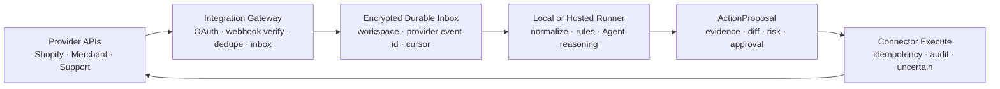

# Pi Web Robin：E-commerce 产品化方案

> 日期：2026-10-04
> 假设：面向小型 DTC / Shopify 运营团队，而不是把现有求职产品简单换皮。
> 与主报告关系：本报告替换主报告中的“Jobs 首发垂直”假设；Core/Robin 解耦、权限、数据迁移和发行安全结论仍然成立。

## 0. 结论

如果目标用户是 e-commerce 经营者，推荐产品不是“电商 Dashboard”或“Shopify Chatbot”，而是：

> **Commerce Ops Agent：每天把 Shopify、商品渠道、供应链和客服信号收敛成 3–7 个有证据、有金额影响、有负责人、有截止期的行动卡。**

首发应聚焦 Shopify DTC 小团队。Shopify 是第一个交易事实源，不是产品边界。产品真正的闭环是：

```text
发现跨系统异常
→ 展示数据来源、freshness、影响和截止期
→ 分配负责人
→ 起草处理动作
→ 人工批准
→ 执行并验证结果
→ 记住本店规则
```

不建议做 Shopify-only AI 助手。Shopify 已经提供 Analytics、Sidekick、Sidekick Pulse 和 App Extensions；Sidekick 能分析数据、管理订单/商品、生成内容并在应用修改前给用户审阅，Pulse 会主动给建议，第三方 App 也能把数据和动作暴露给 Sidekick。[Shopify Sidekick](https://help.shopify.com/en/manual/ai-powered-tools/sidekick)、[Spring ’26 Edition](https://www.shopify.com/news/spring-26-edition-merchant)

因此竞争点必须是 Shopify 原生边界之外的：

- 跨系统异常；
- 本店特有的 SLA、lead time、MOQ、COGS 与负责人；
- 从 insight 到 owner/deadline/approval/outcome 的闭环；
- 可解释、可纠正、可审计的判断；
- 处理历史带来的运营记忆。

---

## 1. “接口”有两层含义

### 1.1 业务接口：用户愿意为什么持续打开产品

除了求职，Robin 的 Today + Pipeline + Agent 模型可以进入这些长期工作流：

| 业务切口 | 持续对象 | 关键事件 | 推荐度 |
|---|---|---|---:|
| E-commerce 运营 | 订单、SKU、库存、履约、商品渠道 | 缺货、积压、拒登、退款、异常 | **首选** |
| 销售 / CRM | 账户、联系人、机会、下一步 | 跟进到期、沉默客户、合同风险 | 高 |
| Agency 客户交付 | 客户、项目、审批、素材 | deadline、scope、反馈、付款 | 高 |
| Creator / 内容运营 | 选题、赞助、内容、发布 | 截止、品牌回复、表现异常 | 中高 |
| 客服运营 | Ticket、客户、退款、SLA | 超时、升级、重复问题 | 中高，但竞争激烈 |
| 研究 / 竞争情报 | 公司、主题、来源、假设 | 价格、产品、政策、竞争变化 | 中 |
| 招聘 | 候选人、职位、面试、offer | 下一步、反馈、失联 | 中 |
| VC / Deal Flow | 公司、轮次、会议、决策 | 新信号、跟进、尽调阻塞 | 中 |

共同原语不是“卡片”或“表格”，而是：

```text
Source → Observation → Signal → Decision → ActionProposal → Outcome
```

每个垂直仍应保留 typed domain model，不能全部压成万能 EAV schema。

### 1.2 技术接口：产品连接哪些外部系统

电商产品需要六类 connector：

1. Storefront / OMS：Shopify、WooCommerce、Amazon；
2. Payment：Shopify Payments/订单事实、Stripe；
3. Analytics / Ads：GA4、Google Ads、Meta Ads；
4. Product Channels：Google Merchant；
5. Lifecycle / Support：Klaviyo、Gorgias、Zendesk；
6. Fulfillment：ShipStation、3PL、供应商 CSV/API。

第一版不能全部接。建议优先级见第 5 节。

---

## 2. 推荐首发用户与产品切口

### 2.1 ICP 假设

建议从以下假设开始访谈，而不是把它当成已验证市场事实：

- Shopify 实物品牌；
- 2–10 人运营团队；
- 至少一人每天负责订单、库存或商品渠道；
- 已同时使用 Shopify 和一个外部来源，例如 Google Merchant、3PL、供应商表格或客服系统；
- 当前靠打开多个后台、邮件和表格找问题；
- 订单和 SKU 数量足以每周产生真实运营异常。

首批设计伙伴最好来自同一个库存敏感子行业，例如服饰配件、家居或消费品，以免一开始就处理完全不同的供应链语义。

暂不服务：

- 低订单量、很少发生日常异常的店；
- 已部署完整 ERP/WMS 和数据团队的大商家；
- Amazon-only seller；
- Dropshipping、数字商品、复杂 B2B；
- 一开始就要求多渠道统一库存的团队。

### 2.2 三个可选切口

| 切口 | 价值 | 难度 | 竞争 | 判断 |
|---|---:|---:|---:|---|
| Store Operations Exception Inbox | 高频、直接关联收入/客户承诺 | 中 | 中 | **推荐** |
| Growth / Profit Analytics | 商家熟悉、数据丰富 | 中高 | 极高 | 不建议首发 |
| Customer Support Copilot | 高频、容易衡量 SLA | 中 | 高 | 可作为第二模块 |

Growth Dashboard 很容易退化成 Shopify Analytics、Triple Whale 或自然语言报表的弱版本。Store Ops Exception Inbox 的价值更具体：它不替代事实系统，而是找出跨系统需要人处理的异常。

---

## 3. 产品界面

### 3.1 默认导航

```text
Today
Store Health
Inventory & Operations
Catalog & Channels
Customers / Inbox       后续
Partners                后续
Experiments             后续
Runs & Health
Agent Studio            高级模式，默认隐藏
```

默认首页仍然是 Today，不是 Chat，也不是 KPI 墙。

### 3.2 Today 页面

顶部只回答运营状态：

```text
今天有 5 件事需要处理
预计风险 $4,820 · 2 件在 24 小时内到期
数据最后同步：Shopify 4m · Merchant 18m · Supplier CSV 2d
```

内容分四组：

1. **Critical now**：预计缺货、超 SLA 未履约、畅销商品拒登、异常退款、连接器失联；
2. **Decide today**：补货建议、字段修复、给 3PL/供应商的询问草稿；
3. **Watch**：趋势恶化但尚未越过行动阈值；
4. **Done & learned**：本周解决了什么、判断是否准确、实际影响是多少。

每张行动卡必须包含：

- 问题；
- 为什么是现在；
- 相关 SKU、订单或渠道；
- 金额/数量风险和计算方法；
- 原始来源与时间戳；
- 数据是否过期；
- 置信度；
- 建议动作；
- Owner 和 deadline；
- `批准`、`创建任务`、`Snooze`、`不相关`、`打开来源`。

示例：

> `SKU-A` 当前可售 84 件，近 14 日销量 20 件/日，预计 4.2 天售罄；供应商 ETA 11 天，可能出现 6.8 天缺货窗口。收入风险估算 $2,100，假设维持当前速度和售价。

关键数值必须由确定性代码计算；LLM 负责解释、归纳、调查与草稿，不能发明库存、利润或金额。

---

## 4. 首个 MVP 工作流

### 4.1 Inventory at Risk

输入：

- Shopify 可售/预留库存；
- SKU 近期销售速度；
- 人工或 CSV 提供的 supplier lead time、MOQ、在途 PO、安全库存；
- 可选 COGS。

输出：

- days of cover；
- 预计缺货日期；
- 风险窗口与影响估算；
- 建议补货量与假设；
- PO/供应商询问草稿。

MVP 不自动提交采购单，也不修改 Shopify 库存。

### 4.2 Fulfillment Exceptions

检测：

- 已付款但超过本店 SLA 未履约；
- 部分履约长时间不动；
- 某仓库/3PL 积压突增；
- 取消、退款、退货异常；
- 订单地址或客户请求需要人工决定。

动作：

- 创建本地任务；
- 起草给 3PL、供应商或客户的消息；
- 聚类共同根因；
- 处理后验证订单状态。

客户消息、退款和取消属于高风险外部动作，必须后置并审批。

### 4.3 Catalog / Channel Health

把 Shopify 与 Google Merchant 对账：

- Shopify active 商品在渠道无效；
- 畅销商品出现 item issue/disapproval；
- SKU、GTIN、重量、图片等字段缺失；
- 价格/库存不一致；
- 商品最终处理状态与输入不一致。

Google Merchant API 能管理商品输入与最终商品状态，并提供产品问题、表现和竞争环境报告。[Merchant API](https://developers.google.com/merchant/api/reference)、[Product issues](https://developers.google.com/merchant/api/guides/products/list-products-data-issues)、[Reports](https://developers.google.com/merchant/api/guides/reports/overview)

### 4.4 Morning Brief

```text
读取昨日变化
→ 与 7/28 日和同星期基线比较
→ 过滤没有行动价值的波动
→ 计算风险、期限和证据
→ 生成最多 3–7 张卡
→ 收集 useful / snooze / dismiss / outcome
```

初期宁可漏掉低价值提醒，也不要制造告警疲劳。Critical 卡的 precision 应成为比“发现数量”更重要的指标。

---

## 5. 外部 API / Connector 路线图

### 5.1 优先级

| 优先级 | 接口 | 用途 | 首发权限 |
|---:|---|---|---|
| P0 | Shopify Admin GraphQL | 订单、商品、库存、客户、退款、履约 | 只读 |
| P0 | Shopify Webhooks | 订单/商品/库存等增量事件 | 接收、验证、去重 |
| P0 | Supplier CSV / manual | lead time、MOQ、COGS、在途 | 本地导入 |
| P1 | Google Merchant API | 拒登、商品问题、渠道表现 | 只读 |
| P1 | Slack / Telegram / Email | Morning Brief 与审批通知 | 只推送，回复后置 |
| P1/P2 | Gorgias 或 Zendesk | Ticket、SLA、客服上下文 | 只读 + internal draft |
| P1/P2 | ShipStation / 3PL | 履约、tracking、label | 只读；买 label 后置 |
| P2 | GA4 Data API | 渠道、landing page、漏斗 | 只读 |
| P2 | Klaviyo | Campaign/flow/event、留存 | 只读 + 草稿 |
| P2 | Google Ads / Meta Ads | 花费、转化、素材异常 | 只读 |
| P2 | Stripe | 独立 Stripe 商家的退款/争议 | 只读；退款后置 |
| P2 | WooCommerce | 第二 storefront | 后置 |
| P3 | Amazon SP-API | Amazon Seller Ops | 独立产品包 |

如果设计伙伴最痛的是增长而非库存，GA4 可提升到 P1；但不要同时承诺库存、广告、客服、物流四条产品线。

### 5.2 Shopify：首个事实源

使用 Admin GraphQL，而不是把 REST Admin 作为新产品核心。核心对象包括 Store、Product、Variant、Inventory、Order、Customer、Refund、Return 和 Fulfillment。

重要约束：

- App 安装后使用 scope 限制的 access token；offline token 可支持后台任务和 webhook；
- 默认订单权限只覆盖最近 60 天，旧订单需要额外的 `read_all_orders`；
- 公开 App 读取订单/客户字段涉及 protected customer data 审核；
- GraphQL 采用 query-cost 限流，初次大量同步应使用 bulk operations；
- Webhook 有版本、可能重复且不保证顺序，必须用 event ID 去重，并定期 reconciliation；
- App Store 分发必须处理 compliance webhooks。

官方资料：[Authentication](https://shopify.dev/docs/apps/build/authentication-authorization)、[Orders](https://shopify.dev/docs/api/admin-graphql/latest/queries/orders)、[Webhooks](https://shopify.dev/docs/apps/build/webhooks)、[Webhook verification/reconciliation](https://shopify.dev/docs/apps/build/webhooks/verify-deliveries)、[Protected customer data](https://shopify.dev/docs/apps/launch/protected-customer-data)、[API limits](https://shopify.dev/docs/api/usage/limits)。

### 5.3 WooCommerce：市场大，但支持成本高

WooCommerce REST API v3 可读写 orders、products、customers、coupons 和 shipping；API key 绑定 WordPress user，可授予 read/write。Webhook 支持 order/product/customer 等 topic 并使用 HMAC-SHA256，但失败多次后可能被禁用。[WooCommerce REST API](https://developer.woocommerce.com/docs/apis/rest-api/)、[Authentication](https://developer.woocommerce.com/docs/apis/rest-api/authentication)、[Webhooks](https://developer.woocommerce.com/docs/apis/rest-api/v3/webhooks/)

每个 WordPress 主机、插件、反向代理、permalink 与安全规则都可能不同，因此它不是“再写一个 adapter”那么简单，还需要连接诊断和兼容矩阵。放在 Shopify PMF 之后。

### 5.4 Amazon SP-API：单独产品线

SP-API 可管理订单、listing、pricing、FBA inventory、reports 和 fulfillment；公开应用需要 OAuth、developer profile、role 与数据安全流程。Notifications 通过 Amazon SQS/EventBridge，不是普通 HTTPS webhook，而且不同 marketplace、PII/Restricted Data Token、Reports 异步工作流与限流都增加复杂度。[SP-API onboarding](https://developer-docs.amazon.com/sp-api/docs/onboarding-overview)、[Notifications](https://developer-docs.amazon.com/sp-api/docs/notification-type-values)

Amazon 的运营痛点可能更强，但实现与合规足以构成另一条产品线。首发不应同时支持。

### 5.5 支付、营销、客服与物流

- **Stripe**：Webhook 可报告付款失败、争议和退款等异步事件；生产 endpoint 要验证签名、保留 raw body、快速返回 2xx 再异步处理。[Stripe Webhooks](https://docs.stripe.com/webhooks) Shopify Payments 商家不能默认被当作普通 Stripe account，因此支付事实优先从 Shopify 读取。
- **GA4**：Data API 提供历史、realtime、pivot 和 funnel 报告，适合只读增长上下文。[GA4 Data API](https://developers.google.com/analytics/devguides/reporting/data/v1)
- **Google Ads**：GAQL/SearchStream 可读取 campaign 至 keyword 的表现；广告预算、bidding、enable/pause 是真实花钱动作，首发只读。[Google Ads reporting](https://developers.google.com/google-ads/api/docs/reporting/overview)
- **Klaviyo**：Events API 可读写 profile activity，Campaign API 能真正发送；system webhooks 只对部分客户/partners 开放，不能把它当成普遍事件基础。[Events API](https://developers.klaviyo.com/en/reference/events_api_overview)、[Webhooks API](https://developers.klaviyo.com/en/reference/webhooks_api_overview)
- **Gorgias/Zendesk**：可读 ticket/customer/message，也可创建真实外发消息；MVP 只生成 internal note 或 draft。Zendesk ticket creation支持幂等键，可作为 connector contract 的参考。[Gorgias Tickets](https://developers.gorgias.com/reference/list-tickets)、[Zendesk Ticketing](https://developer.zendesk.com/api-reference/ticketing/introduction/)
- **ShipStation**：可管理 orders、shipments、labels、rates 和 webhooks；购买 label 是付费外部动作，必须审批。[ShipStation API](https://www.shipstation.com/docs/api/)

---

## 6. 产品形态：电商不能是纯本地桌面

Shopify、Stripe、Merchant、Klaviyo 和客服系统的 OAuth callback / webhook 需要长期在线的公网 HTTPS endpoint。商家电脑关机后，订单和库存事件仍然发生。

因此推荐：



Gateway 不是云端高权限 Agent：

- 不开放 shell；
- 不读取用户任意文件；
- 不让模型直接调用 provider SDK；
- 只做 OAuth、验签、事件收件箱、离线队列、cursor 和连接健康；
- raw payload 按最短必要保留期保存并加密；
- Runner 在线后拉取，或由受限 hosted worker 处理确定性规则。

### 6.1 两条实施路径

#### Concierge/private MVP

- Shopify custom/private distribution；
- read-only token；
- 本地或单租户部署轮询；
- 手工导入 supplier CSV；
- 不进 Shopify App Store；
- 用 5 家设计伙伴验证行动卡。

优点是 2–4 周可以验证价值；缺点是 onboarding 手工、不能作为公众产品。

#### Public product

- Shopify OAuth/App distribution；
- Hosted Gateway + durable queue；
- protected customer data 与 compliance webhook；
- workspace identity、KMS/Vault、Postgres；
- embedded Shopify entry + 独立 Today 页面；
- 本地 Runner 是隐私/高级模式，普通用户可选 hosted processing。

这比主报告的“Electron first”更适合电商。Electron 可以保留为高级本地 edition，但不应是 Shopify 商家的唯一入口。

---

## 7. 领域模型与 Connector 合约

### 7.1 领域实体

```text
Workspace
StoreConnection
Store
Product / Variant
InventoryPosition
Order / Fulfillment / Refund / Return
Supplier / PurchaseOrder
MetricObservation
Signal
ActionItem
ActionProposal
ActionAttempt
Outcome
SyncRun
WebhookInbox
AuditEvent
```

本地/云端 projection 不是事实源。每条记录都需要：

- `workspaceId` / `storeId`；
- provider、external ID、source revision；
- observed/occurred/received time；
- freshness；
- raw event hash；
- sync cursor；
- schema/API version。

### 7.2 不要让 Agent 直接认识 Shopify SDK

第一版可以从三个窄接口开始：

```ts
interface StorefrontReader {
  syncCatalog(cursor?: string): Promise<SyncPage<CatalogRecord>>;
  syncOrders(cursor?: string): Promise<SyncPage<OrderRecord>>;
  syncInventory(cursor?: string): Promise<SyncPage<InventoryRecord>>;
}

interface CommerceWebhookAdapter {
  verify(headers: Headers, rawBody: Uint8Array): VerifiedWebhook;
  normalize(event: VerifiedWebhook): DomainEvent[];
}

interface MarketingMetricsReader {
  readDailyMetrics(range: DateRange): Promise<MetricObservation[]>;
}
```

等 WooCommerce 或 Amazon 成为第二实现后，再提炼更宽的 `CommerceConnector`。不要为了“平台化”先定义一个包含所有供应商能力的巨大接口。

### 7.3 Capability 模型

```text
catalog.read / catalog.write
orders.read / orders.cancel / orders.refund
inventory.read / inventory.write
fulfillment.read / fulfillment.write
payments.read / payments.refund
analytics.read
ads.read / ads.write
support.read / support.draft / support.send
messaging.read / messaging.draft / messaging.send
```

权限升级路径：

```text
L0 Observe
→ L1 Draft / local task
→ L2 Human-approved external write
→ L3 Narrow policy-bound automation
```

退款、取消订单、价格/库存、广告预算、Campaign 发送、客服外发和购买 label 都不能让模型直接执行。

每次外部写入必须绑定 exact target + exact payload + revision + approver + idempotency key。payload 改变后原审批立即失效；调用结果不确定时进入 `uncertain`，不得自动重试。

---

## 8. 当前 pi-web-robin 如何复用

### 8.1 基本保留

| 当前资产 | Commerce 用法 |
|---|---|
| Pi session / SSE / reconnect | Agent Runtime 与高级 Studio |
| `tools.ts` 的窄工具集 | commerce read / draft / external-write policy |
| HTTP 与 Pi Tool 共用 domain | Route、Agent、Worker 调同一 use case |
| Todo / Calendar | 经营行动、补货和 supplier deadline |
| Gmail Review | 平台通知、供应商、退款/批发邮件 triage |
| Delivery Ledger | Webhook、digest、通知幂等 |
| Outreach `claim / uncertain` | 所有不可逆外部动作的状态机 |
| Job intake 的 normalize/dedupe/evidence | Commerce Signal Intake 管线 |
| Scheduler / lease 经验 | Store sync、分析、reconciliation |
| Dashboard / Today shell | Action Inbox 骨架 |
| Notes / Links | SOP、supplier context、incident notes |

### 8.2 保留机制、重写语义

- `Job` 不能改名为 `Product`；只复用 source → normalize → dedupe → score → retain 的管线结构；
- Job scoring 变成 Signal detection/priority，但金额与库存算法必须确定性；
- Jarvis CRM 改成 supplier/creator/wholesale partner CRM，移除个人 ICP 与冷外联默认策略；
- Product Ideas 应改名为 Experiments，它当前表示创业想法而非商品 catalog；
- Mail 分类从求职/OA/interview 改成 order/customer/supplier/platform/finance；
- Dashboard 由 module contributions 聚合，不再固定 Jobs/Learning；
- Assistant modes 改为 policy registry，例如 `commerce_analysis`、`draft_action`、`incident_investigation`。

### 8.3 Commerce 默认发行版关闭

- Jobs、Rounds、CV、ATS；
- FSO、NeetCode、Learning；
- Tech Events、Podcast、个人研究；
- 当前 Cold Reach 自动化与个人品牌文案；
- Terminal、File Explorer、Worktree；
- 开放式全工具 Agent。

这些功能先用 product profile 从导航、route、tool 和发行物中移出，不必立即删除源码。

---

## 9. 12 周实施计划

| 阶段 | 周 | 交付 | 退出条件 |
|---|---:|---|---|
| Discovery | 1–2 | 15 次访谈、5 个真实 incident replay、数据样本、规则词典 | 找到重复出现且有明确损失的 3 类异常 |
| Commerce foundation | 2–3 | Product profile、workspace/store context、SQLite、SecretStore、typed contracts | Commerce build 不加载 Career/Learning/Terminal |
| Shopify read-only | 3–5 | Auth、initial/bulk sync、cursor、连接健康 | 测试店 catalog/order/inventory snapshot 可恢复 |
| Event & reconciliation | 5–6 | webhook inbox、验签、去重、乱序处理、reconcile job | 重放/重复/漏事件测试通过 |
| Signal engine | 6–8 | stockout、fulfillment、refund/catalog 三类规则 | 每条卡有证据、freshness、确定性计算 |
| Today & workflow | 8–9 | owner、deadline、snooze、resolve、feedback、digest | 商家无需 Chat 即可处理完整工作流 |
| Second source | 9–10 | Merchant 或设计伙伴最重要的系统 | 证明跨系统卡优于 Shopify 原生提醒 |
| Agent + proposals | 10–11 | 调查、解释、草稿、ActionProposal；无外部写 | 不可信商品/邮件不能获得写工具 |
| Concierge beta | 11–12+ | 5–10 家店、weekly outcome review | 达到第 10 节门槛后才做公开 App |

### 9.1 首批 PR

1. ADR：Commerce ICP、Today、只读 MVP 与非目标；
2. Product profile/module registry，Commerce build 隐藏 Career/Learning/Terminal；
3. `workspaceId/storeId/actorId/requestId` context；
4. StoragePort、SecretStore、Clock、UUID；
5. SQLite commerce schema + JSON importer；
6. Shopify read-only connector + connection health；
7. SyncRun + webhook inbox + dedupe/replay/reconciliation；
8. Signal Intake，先做三类确定性规则；
9. Store Health + Today cards；
10. ActionProposal / Approval / Attempt / `uncertain`；
11. Commerce Assistant policies 与 prompt-injection tests；
12. Google Merchant 或首个设计伙伴 connector。

第一轮不要同时做 Meta Ads、Klaviyo、Amazon 和自动执行。

---

## 10. 验证门槛

先做 15 次问题访谈和 5 个 concierge pilot。要求商家展示最近三次真实事故、后台和表格，不只询问“想不想要 AI”。

四周、10 家店的建议门槛：

### 激活

- P50 从连接到第一张行动卡少于 15 分钟；
- ≥70% 店铺首日出现一张被确认有用的卡；
- ≥80% 能完成 Shopify + 第二来源连接。

### 质量

- Critical 卡人工确认 precision ≥80%；
- 全部卡 useful rate ≥40%；
- Critical false-urgent rate <10%；
- 100% 卡片有 source 与 freshness；
- 不完整数据会降低置信度，不伪装成确定结论。

### 使用与价值

- 10 家中至少 6 家在第 4 周仍活跃；
- 目标商家平均每周处理至少 2 张卡；
- 至少一半活跃店使用 owner/deadline；
- 至少 5 家确认每周节省 2 小时，或记录一次真实损失避免；
- 至少 4/10 真正付费，而不是只口头表示愿意。

### 安全与可靠性

- 未审批外部写入：0；
- 重复外部动作：0；
- Scheduled sync 成功率 ≥99%；
- 过期数据被当成实时数据：0；
- Webhook replay 不改变最终 projection；
- 所有高风险执行都可追到 approver、payload、receipt 和 provider event。

如果用户最终只需要漂亮报表或自然语言查询，应停止这个方向；Shopify 原生能力和成熟 BI 工具会更强。只有商家愿意为跨系统异常、责任交接和 outcome 闭环付费，才值得投资公开 App 审核、Hosted Gateway 和更多 connector。

---

## 11. 最终产品判断

电商比求职更适合长期订阅：订单、库存和渠道每天变化，问题不会因为用户“找到工作”而结束。但它也更依赖 24/7 接入、平台审核、客户数据保护和零失误的外部动作。

因此推荐路线是：

> **以 Shopify DTC 的 Store Ops Exception Inbox 切入；Shopify + supplier data + Google Merchant 构成首个跨系统闭环；Today 是产品，Agent Chat 是调查工具；所有外部写入先只做草稿和审批；用最小 Hosted Gateway 解决 OAuth/webhook/离线队列，而不是把当前 Next + Terminal 直接变成 SaaS。**

这个方向复用 Robin 的不是 `Job` 类型，而是它已经积累的运行时、受限工具、intake/dedupe/evidence 管线、任务调度、delivery ledger、审批和 `uncertain` 外部副作用语义。
