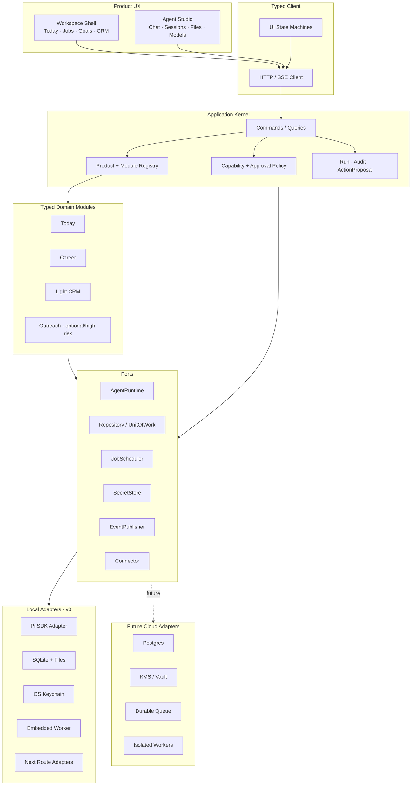

# Pi Web Robin 产品化抽象与实施报告

> 版本：2026-10-04
> 范围：将当前 `pi-web-robin` 从个人项目抽象为可安装、可升级、可验证、以后可演进到商业产品的 Agent WebUI + Dashboard。
> 依据：仓库代码、`CONTEXT.md`、现有 ADR、现有产品与竞品报告，以及本次只读架构、安全、发行审计。

> **E-commerce 版本：** 如果首发用户是商家而不是求职者，产品形态、连接器与云端边界会变化，请以 [E-commerce 产品化方案](./pi-web-robin-ecommerce-product-plan.md) 为准。

## 0. 执行摘要

建议把它做成：

> **一个本地优先、用户拥有数据、由 Agent 持续维护的个人工作台；以求职工作流切入，Today 是首页，Pi Agent Console 是可选的高级模式。**

不是把当前仓库直接包装成 SaaS，也不是先造一个任意领域的低代码 Dashboard Builder。正确顺序是：

1. **先产品化现有能力**：安装、升级、数据迁移、任务可靠性、权限、审计、恢复。
2. **再抽象已经被两个真实垂直场景验证的部分**：第一垂直是 Jobs，第二垂直建议是轻 CRM。
3. **最后才考虑 SaaS / 插件市场 / 任意 Workspace 生成**。

核心决策如下：

| 决策 | 建议 |
|---|---|
| 首个用户 | 有明确求职目标、愿意让 Agent 帮其持续发现和推进机会的技术型知识工作者 |
| 首个价值承诺 | 不漏掉值得申请的职位和需要推进的下一步；每项建议都可解释、可纠正 |
| 产品首页 | Today，而不是 Chat，也不是一组静态 Dashboard |
| 首个深垂直 | Jobs + Rounds + Calendar + Todo |
| 第二验证垂直 | 轻 CRM；用于验证抽象是否真的跨领域 |
| Agent WebUI | 保留为 `Agent Studio` 高级模式，不作为普通用户默认入口 |
| 运行形态 | Mac 优先的本地桌面应用；Electron 是当前最短路径 |
| 架构 | 模块化单体 + ports/adapters；现在不拆微服务 |
| 数据 | SQLite 为产品运行数据；保留 JSON 导入、可读导出和 Pi JSONL 会话 |
| 密钥 | OS Keychain；不得继续把产品密钥默认放在明文 `secrets.json` |
| 自动化 | 持久化 Job、lease、幂等键、运行记录；不能依赖进程内 timer/Map |
| 云端路线 | 先不做完整 SaaS；未来做本地 daemon + 云控制平面的混合模式 |
| 预计周期 | 高级单人开发约 12–16 周到私测；2 名工程师约 8–10 周 |

### 公开 beta 前必须修复的阻断项

本次审计发现一个 P0：README 声称 Terminal API 必须有密码且只能 loopback 使用，但当前实现并没有终端专属校验；当 `dev:lan` / `start:lan` 在未设置密码时运行，通用代理会直接放行，而终端可启动继承宿主大部分环境变量、拥有当前 OS 用户权限的 shell。证据分别位于：

- [README.md](../README.md) 第 152–160 行；
- [proxy.ts](../proxy.ts) 第 43–49 行；
- [app/api/home/route.ts](../app/api/home/route.ts) 与 [app/api/cwd/validate/route.ts](../app/api/cwd/validate/route.ts)：可发现 home 并把存在的目录加入可访问根；
- [app/api/terminal/route.ts](../app/api/terminal/route.ts) 第 10–35 行；
- [bin/pi-web.js](../bin/pi-web.js) 第 69–79 行；
- [lib/terminal-manager.ts](../lib/terminal-manager.ts) 第 45–57、74–105 行。

在修复前，不应把当前服务暴露到 LAN、反向代理或公网。消费产品构建应默认完全关闭 Terminal；高级模式也必须由独立 capability、桌面会话令牌和本机绑定共同保护。

---

## 1. 这次报告解决什么问题

仓库里已经有两份很有价值的前置材料：

- [产品讨论总结](./产品讨论总结.md)：产品定位、市场切口、Today / Goals / Pipeline 的初步判断；
- [个人 agent dashboard 竞品调研](./个人%20agent%20dashboard%20竞品调研.md)：市场、竞品、Gmail 合规和商业模式背景。

这份报告不重复做一次竞品罗列，而是回答四个更具体的问题：

1. 当前代码中，哪些是真正可复用的产品资产，哪些只是个人化内容？
2. Agent WebUI、Robin Dashboard、领域模块和发行层应该怎样划界？
3. 如何在不大爆炸重写的情况下，从 JSON + Next 单进程迁移到可靠桌面产品？
4. 什么条件满足后，才值得进入 SaaS、多用户和平台化？

### 1.1 本报告的关键修正

此前的产品讨论提出了通用 `WorkspaceSpec`。方向是对的，但现在直接做全通用 schema 还太早。Jobs 已经很深，轻 CRM 还没有成为同等成熟的第二实现；此时把所有领域压成一个通用 Collection / View / Pipeline 模型，很容易得到大量 `Record<string, unknown>`、条件分支和无法表达的领域不变量。

因此建议改成：

- 第一阶段定义**有类型的 `WorkspaceModule` 合约**；
- Jobs、Today、轻 CRM 仍保留各自的领域模型；
- 只有在两个模块中真正重复、且不变量一致的能力，才提升到 Kernel；
- `WorkspaceSpec` 作为后续的声明式层，而不是 v0 的底座。

同理，不应“直接把 `rpc-manager.ts`、`paths.ts` 搬进 Kernel”。它们是成熟但具体的实现，应该先被 `AgentRuntime`、`StoragePort` 等接口包住，再逐步内部拆分。

---

## 2. 当前代码基线：已经拥有的资产与结构性负债

### 2.1 规模与演化压力

截至本次审计：

- 相对 `upstream/main`：当前分支落后 2 个提交、领先 148 个提交；
- 差异规模：621 个文件，约 97,358 行新增、3,137 行删除；
- API route 共 98 个，其中 Robin route 38 个；
- `components/robin` 有 74 个 TSX 文件；
- `extension/robin` 有 100 个 TypeScript 文件；
- 仓库有 324 个 `.test.mjs` 文件；
- 主要大文件：
  - `components/AppShell.tsx`：2,656 行；
  - `components/ChatWindow.tsx`：2,262 行；
  - `hooks/useAgentSession.ts`：2,487 行；
  - `lib/rpc-manager.ts`：2,177 行；
  - `app/globals.css`：4,418 行。

这说明项目不是 PoC；它已经有足够多的业务资产值得保留。但 Robin 与上游 Pi Web 的改动混在一起，继续在同一层修改会让升级成本越来越高。

### 2.2 值得保留的资产

| 资产 | 为什么有价值 | 产品化动作 |
|---|---|---|
| Session 浏览、分支、恢复、SSE 生命周期 | 已处理许多 Pi SDK 与浏览器边缘情况 | 保留行为，用 typed facade 隔离实现 |
| `*-domain.ts` + HTTP/Pi Tool 共用用例 | 已经开始形成多入口共享业务规则 | 抽 repository、clock、ID、context 端口 |
| Tool allow-list | 对不可信邮件/JD 已使用最小工具集 | 提升为正式 capability policy |
| Outreach `claim / uncertain` 语义 | 正确处理不可确认外部副作用，避免重复发送 | 作为所有不可逆动作的参考状态机 |
| 文件原子 rename 与锁 | 适合当前单机低并发 | 保留为 JSON 兼容 adapter，不作为产品数据库 |
| `usePolledResource` 的取消与防旧响应覆盖 | 简单而正确的本地轮询实现 | 保留为 fallback；产品事件流做主通道 |
| Request host/origin 防护 | 当前安全边界的重要基础 | 加 capability/auth，不要删除现有检查 |
| 现有测试与 ADR | 大量行为与历史决策已固化 | 把源码形状测试逐步转成契约/行为测试 |

Todo 是当前共享用例的好样板：HTTP route 和 Pi Tool 都调用 `todo-domain.ts`。Jobs、Calendar、Mail 也已经有类似雏形。Outreach 的 `sending -> uncertain` 规则更是有产品价值的领域知识，不应在队列迁移中被“普通自动重试”抹掉。

### 2.3 当前最重要的结构性负债

#### A. Core 与 Robin 存在反向依赖

- [components/AppShell.tsx](../components/AppShell.tsx) 直接导入 `AssistantPalette` 与 `RobinMargin`；
- 根 layout 固定品牌和 PWA metadata；
- Core usage API 导入 Robin provider；
- 通用 request security 硬编码 Robin Google callback；
- i18n registry 同时绑定 core 与 Robin 文案。

第一条架构验收线应是：**临时移除 Robin 源码后，纯 Pi Web Core 仍能编译、启动并通过核心 E2E。**

#### B. Agent UI 是高内聚功能，不应机械拆 hooks

`useAgentSession` 暴露大量 state、setter、ref 和动作，但这些状态围绕一个强耦合的 Agent 生命周期。按“模型、滚动、SSE、消息”机械切成十几个 hook，只会把依赖藏进 callback 和 ref。

正确步骤是：

1. 暂时把 `ChatWindow + useAgentSession` 当成一个内部 feature；
2. 对外先收窄成语义 facade，例如 `session`、`execution`、`composer`、`model`、`extensions`；
3. 让子组件只消费所需 slice；
4. 再把无 DOM 的状态机与传输层移到 `core-client`。

#### C. Robin 前端是硬编码的组合，而不是模块注册

[RobinMargin.tsx](../components/robin/RobinMargin.tsx) 第 144–151 行直接启动 7 个轮询，第 177 行后硬编码导航和 badge；至少数十个 Robin 组件直接写 `/api/robin/...`。

它需要的是 module registry、typed client 和统一 query invalidation，而不是再增加一个中心 switch。

#### D. 单机、单用户、单进程假设遍布全栈

- 数据固定在 `ROBIN_DATA_DIR || ~/.pi/robin`；
- JSON 锁是同步、单文件、单机锁；
- `newId()` 使用 `Math.random()`；
- Agent wrapper、OAuth state、任务 busy 状态、timer 存在 `globalThis` 或模块级 Map；
- `instrumentation-node.ts` 在 Web 进程启动日常任务和 outbox；
- 所有数据、secret、OAuth account、session 都没有 `workspaceId`。

这些对个人工具合理，对产品可靠性和多实例部署不成立。

#### E. 后端 route 与 wire protocol 边界太松

部分 route 同时承担解析、校验、业务编排、文件操作和响应；Agent command 接收宽泛对象，event 主要以 `{ type: string }` 表达，返回值常为 `unknown`。前后端升级时容易静默错配。

目标是：所有公开 HTTP、SSE 和桌面 IPC 输入输出都有运行时 schema、稳定错误码和 `protocolVersion`；route 只做认证、校验、调用和响应映射。

#### F. 发行链仍然是上游 Pi Web，不是 Robin 产品

- `package.json` 的包名、主页、仓库、issue 地址和 `release` 都指向 `@agegr/pi-web`；
- npm `files` 白名单只包含 `bin`、`.next`、`public` 等，并未把 Robin extension 与 Telegram worker 作为独立运行资产交付；
- App Update 每 12 小时读取上游 npm 包，release link 也硬编码到上游仓库；
- README 仍要求手工建立 Robin extension symlink、单独启动 Telegram；
- `package.json` 与 `bun.lock` 中的 Pi、Next、Undici 版本已经漂移。

这意味着当前“打包成功”也可能产生身份错误、资产不全、更新到错误产品的发行物。必须选择一个权威包管理器/锁文件，并对最终安装包做空目录安装与启动测试。

#### G. 产品数据与源码工作树尚未完全隔离

当前未跟踪的 `outputs/`、外联脚本和模板中可能包含联系人、邮箱与业务结果，而 `.gitignore` 主要只覆盖环境文件。产品化必须定义独立的 user-data root、cache root、secret root 和 export root；发布 CI 还要增加 secret/PII pattern scan，禁止真实用户数据进入源码、安装包和测试 fixture。

安全文档也已经出现漂移：README 对 Terminal、删除工具和 Google read-only 的描述与当前实现不完全一致。今后安全承诺应由 executable tests 固定，而不能只靠文档同步。

---

## 3. 产品定义：卖什么，而不是展示什么

### 3.1 推荐的一句话定位

> **一个替你持续盯住求职机会和下一步、只在需要你决定时打扰你的本地 Agent 工作台。**

“本地”“Dashboard”“Agent”都是实现或差异化，不是用户购买的任务。用户购买的是：不错过、知道为什么、能快速采取下一步、不会被 Agent 擅自替他做不可逆动作。

### 3.2 v0 用户体验

产品默认导航应是：

1. **Today**：今日需要用户决策或行动的项目，展示来源、原因、截止时间、建议动作；
2. **Jobs**：发现、评分、shortlist、申请、面试、offer 的持续状态；
3. **Goals**：3–5 个长期目标以及与 Today/Jobs 的关联；
4. **Light CRM**：用于第二垂直验证，不必一开始公开给所有用户；
5. **Runs / Health**：后台任务是否成功、何时重试、为什么失败；
6. **Agent Studio（高级）**：Chat、session、文件、工具、模型；默认折叠或由高级设置启用。

Agent 不应该只产生聊天消息。每次有业务意义的输出应落成下面四类对象之一：

- `RecordChange`：本地结构化状态变化；
- `TodayItem`：需要用户关注的行动项；
- `ActionProposal`：需要审批的外部动作草稿；
- `RunResult`：扫描、评分、同步、摘要的运行结果与证据。

### 3.3 v0 明确不做

- 任意自然语言生成新 Workspace；
- 插件市场；
- 多租户 SaaS；
- 云端 shell / 任意文件访问；
- 自动投递职位或自动发送外联；
- 复杂 BI 图表与页面搭建器；
- 完整手机 App；
- 同时支持 Mac、Windows、Linux 三个平台的正式发行。

### 3.4 为什么 Agent Console 不能是普通用户首页

当前 Pi Web 对开发者很强，但 session、model、thinking level、tool preset、文件和 terminal 都是实现概念。把这些直接交给普通用户，会让“完成工作”变成“管理 Agent”。

因此产品应是两层体验：

| 层 | 面向谁 | 默认能力 |
|---|---|---|
| Workspace Shell | 普通用户 | Today、Jobs、Goals、审批、运行健康、连接器 |
| Agent Studio | 高级用户/调试 | Session、模型、工具、文件、可选 Terminal |

两者共享运行时，但使用不同 capability profile。Studio 不是另一个后端，也不是复制一套 Agent。

---

## 4. 目标边界：四个层，不是一个“万能平台”

### 4.1 建议的模块层次



### 4.2 两种不同的扩展点

需要明确区分：

1. **Product Definition**：品牌、导航、layout slots、设置、i18n、OAuth callback、发行能力；解决 Core 与 Robin 解耦。
2. **Workspace Module**：领域命令、查询、页面、badge、tool policy、jobs、migration；解决 Dashboard 模块化。

Pi 本身已经有 extension/tool/resource 系统。不要再造一套重复的 Agent 工具插件机制；Product SDK 只组合 Web 产品，Workspace Module 只注册领域能力。

### 4.3 目标目录

这是目标状态，不要求第一周一次性搬完：

```text
apps/
  robin-web/               Next composition root
  robin-desktop/           Electron main/preload/packaging
  pi-web/                  可选的纯 Agent Workstation composition

packages/
  contracts/               HTTP/SSE/IPC DTO、schema、错误码、协议版本
  core-server/             session/workspace/security application services
  core-client/             typed client、EventSource、无 DOM 状态机
  agent-runtime-pi/        Pi SDK adapter
  agent-console/           Chat/Session/File/Model 高级 UI
  product-kernel/          context、policy、audit、run、scheduler ports
  workspace-sdk/           ProductDefinition / WorkspaceModule contracts
  workspace-shell/         Today/navigation/settings/common UI
  workspaces/
    career/
    today/
    light-crm/
  adapters/
    storage-json/
    storage-sqlite/
    secrets-keychain/
    scheduler-local/
  connectors/
    google-calendar/
    gmail/
    ats/
    telegram/
```

不要先移动目录再找边界。先在现有目录中建立接口和依赖规则；当 Core 可以在没有 Robin 的情况下启动、Robin 只能经过公开合约组合时，再移动 package。

---

## 5. 最小公共合约

### 5.1 请求与运行上下文

即便 v0 只有一个本地用户，也应从第一天传递 context，避免未来每张表和每个 Map 再做一次危险迁移：

```ts
export interface RequestContext {
  requestId: string;
  actorId: string;
  workspaceId: string;
  source: "web" | "desktop" | "agent" | "worker" | "telegram";
  locale: string;
  timeZone: string;
  capabilities: readonly Capability[];
}
```

`workspaceId` 必须由认证/桌面会话构建，不能相信 request body。

### 5.2 Product 与 Workspace 合约

```ts
export interface ClientProductDefinition {
  id: string;
  brand: BrandDefinition;
  navigation: readonly NavigationContribution[];
  settings: readonly SettingsContribution[];
  locales: readonly LocaleContribution[];
  slots: ProductSlots;
}

export interface WorkspaceModule {
  id: string;
  version: number;
  routes: readonly RouteContribution[];
  navigation: readonly NavigationContribution[];
  commands: CommandRegistry;
  queries: QueryRegistry;
  toolPolicies: readonly ToolPolicy[];
  jobs: readonly JobDefinition[];
  migrations: readonly ModuleMigration[];
}
```

第一版采用构建时注册，不做远程动态插件。禁用一个模块时，应同时禁用其导航、API、tools 和后台 jobs。

### 5.3 Agent Runtime 端口

`lib/rpc-manager.ts` 不应成为公共 Kernel；它应实现下面的端口：

```ts
export interface AgentRuntime {
  create(input: CreateAgentSession): Promise<AgentSessionRef>;
  snapshot(ref: AgentSessionRef): Promise<AgentSnapshot>;
  execute<C extends AgentCommand>(ref: AgentSessionRef, command: C):
    Promise<AgentCommandResult<C>>;
  events(ref: AgentSessionRef, cursor?: string): AsyncIterable<AgentEvent>;
  dispose(ref: AgentSessionRef): Promise<void>;
}
```

Pi 的 `SessionManager`、JSONL entry、`AgentSessionWrapper`、fork 特殊语义留在 adapter 内。Kernel 只认识产品 DTO。

### 5.4 存储与事务端口

不要把所有业务强塞进一个通用 `CollectionStore`。使用模块 repository，并共享事务、审计和事件基础设施：

```ts
export interface UnitOfWork {
  run<T>(ctx: RequestContext, work: (tx: Transaction) => Promise<T>): Promise<T>;
}

export interface TodoRepository {
  list(ctx: RequestContext, tx?: Transaction): Promise<Todo[]>;
  save(ctx: RequestContext, todo: Todo, tx?: Transaction): Promise<void>;
}
```

现有 JSON 实现先成为 adapter；随后增加 SQLite adapter，并对两者运行相同 contract tests。

### 5.5 能力与审批模型

把现有 tool allow-list 泛化成少量可解释的能力层级：

- `read_local`
- `read_external`
- `mutate_local`
- `draft_external_action`
- `execute_external_action`
- `destructive`
- `terminal`

权限由服务器根据 actor、workspace、persona、module 和当前 run 计算；浏览器不能提交任意 tool names 来扩大权限。任何 `execute_external_action` 和 `destructive` 默认都生成 `ActionProposal`，必须经过明确确认。

---

## 6. 当前代码到目标边界的映射

| 当前代码 | 目标归属 | 处理方式 |
|---|---|---|
| `components/AppShell.tsx` | `core-react/shell` | 先增加 Product slots/registry，再拆导航和设置；Core 不再 import Robin |
| `ChatWindow.tsx` + `useAgentSession.ts` | `agent-console` | 先收窄 facade，不机械拆 hook；后抽纯状态机 |
| `lib/rpc-manager.ts` | `agent-runtime-pi` | 先包 `AgentRuntime`，再内部拆 factory/registry/dispatcher |
| `lib/session-reader.ts` | Pi session adapter | 保留 JSONL 兼容和分支语义，不进入通用领域模型 |
| `RobinMargin.tsx` | workspace shell + module registry | 导航、badge、权限、route 由 manifest 贡献 |
| `usePolledResource.ts` | core client fallback | 保留轮询；主链路改为 revision/event invalidation |
| `extension/robin/*-domain.ts` | typed domain modules | 抽 context/repository/clock/id/connector，保留业务规则 |
| `extension/robin/store.ts`、`paths.ts` | `storage-json` adapter | 保留导入兼容；不再由 domain 直接 import |
| `extension/robin/tools.ts` | capability policy registry | 保留窄 tool set；按 run 持久化实际授权 |
| `lib/robin-assistant.ts` | assistant orchestrator | 依赖 AgentRuntime、PolicyRegistry、SessionRepository、Clock |
| `instrumentation-node.ts`、Jarvis timers | scheduler/worker | 改为持久 job + lease；Web 进程不直接拥有任务 |
| `settings.ts`、Google token 文件 | connection/secret adapters | metadata 入 DB，token 入 Keychain/KMS |
| `delivery-ledger.ts` | durable delivery store | 保留幂等语义，替换文件实现 |
| `Dashboard.tsx` | read-model composition | 只读多个 query，不成为领域依赖 |
| FSO、NeetCode、SF events、个人品牌数据 | content packs / private modules | 不进入平台内核，默认产品可不安装 |

### 6.1 不应抽象的东西

- 不把所有领域记录统一为 `Record<string, unknown>`；
- 不把 Pi JSONL 格式变成产品数据库 schema；
- 不把 `useAgentSession` 按文件大小机械拆散；
- 不让 Dashboard widget 直接承载领域规则；
- 不把个人化来源、城市、学习清单写进 Kernel；
- 不把 current route 直接复制成“公共 SDK”。

---

## 7. 数据架构与迁移

### 7.1 v0 数据选择

推荐：

- **SQLite**：Workspace、Todo、Job、Round、Goal、Run、Audit、ActionProposal、Connection metadata、Schedule；
- **文件系统**：附件、模型生成的大文件、导出包，使用内容 hash 和 DB 引用；
- **OS Keychain**：OAuth refresh token、API key、Telegram token；
- **Pi 原生 JSONL**：Agent session 暂时继续由 Pi 管理，产品 DB 只保存引用、归属和 UI metadata；
- **JSON 导出**：用户可读、版本化、可恢复，保证“本地拥有”不是口号。

SQLite driver 要在 Electron 打包 spike 后定；当前已经依赖 `node-pty` 原生模块，再增加原生 SQLite driver会扩大跨平台发行矩阵，应通过实际安装包验证，而不是只在开发机通过。

### 7.2 建议的核心实体

```text
Workspace
UserProfile / LocalActor
ModuleInstallation
Goal
TodayItem
Run
RunEvent
AuditEvent
ActionProposal
Schedule
JobLease
DeliveryAttempt
Connection

Career: JobPosting, JobEvaluation, Application, InterviewRound
CRM: Contact, Relationship, Interaction, NextStep
```

每个实体至少有 `id`、`workspace_id`、`created_at`、`updated_at`、`revision`；重要写操作有 `created_by` / `updated_by`。新 ID 使用 UUIDv7 或 ULID，导入时保留旧 ID 映射。

### 7.3 JSON -> SQLite 的安全迁移

1. 给当前 JSON 格式建立 schema 和 golden fixtures；
2. 关闭写入或取得 workspace 迁移锁；
3. 复制完整数据目录并生成 checksum manifest；
4. dry-run 解析、校验、报告损坏/孤儿/重复 ID；
5. 在单个 SQLite transaction 中导入；
6. 运行逐领域 count、ID、关键字段与不变量比较；
7. 写入 migration marker 和源 checksum；
8. 短期 dual-read compare，只比较结果，不双写；
9. 切换后保留只读 JSON 备份和一键回滚窗口；
10. 导出/恢复测试通过后，才删除旧写路径。

不要长期 dual-write。JSON 与 SQLite 的事务边界不同，长期双写会制造比迁移本身更难处理的不一致。

### 7.4 修复隐式写查询

当前一些 GET/list 操作会 prune、修复或同步其他文件。产品化后要改为：

- 写入事务中的 invariant；
- 显式 maintenance/reconciliation command；或
- 可审计的后台 job。

Query 应尽量无副作用，否则缓存、只读模式和审计都会失去语义。

---

## 8. 安全模型

### 8.1 信任区

| 区域 | 默认信任 | 主要风险 | 控制 |
|---|---|---|---|
| Renderer/UI | 低 | XSS、被污染内容、越权 IPC | schema、CSP、context isolation、最小 bridge |
| Next/API adapter | 中 | CSRF、伪造 workspace、绕过 policy | 服务端 context、origin/host、capability policy |
| Kernel/Worker | 高 | 高权限工具、重复任务、secret 泄露 | run grant、lease、audit、secret refs |
| 邮件/JD/网页 | 不可信 | prompt injection、恶意链接 | 窄工具集、结构化输出、无外部写权限 |
| 外部副作用 | 不可逆 | 重复邮件、误删、错误投递 | proposal、人工确认、幂等、`uncertain` 状态 |

### 8.2 Terminal P0 的目标修复

消费产品：

- 编译/运行配置中默认不注册 Terminal route；
- Studio 启用 Terminal 时要求 `terminal` capability；
- 只接受桌面主进程签发的短期 session token；
- 始终绑定 `127.0.0.1` 或受控 IPC，不允许 LAN；
- shell 环境采用 allow-list，而不是复制整个 `process.env`；
- 对启动、输入、cwd、退出写入审计；
- 增加“无密码 LAN 不可创建 terminal”的集成测试。

当前共享密码只能作为开发/单用户自托管门禁，不能作为正式身份系统。

### 8.3 Electron 安全基线

Electron 是当前最短路径，因为现有产品依赖 Node、Pi SDK 和 `node-pty`。但 Renderer 获得的是高价值本机能力，必须遵循官方安全基线：关闭 Node integration、启用 context isolation 和 renderer sandbox、限制导航/新窗口、验证 IPC sender、只暴露窄的 preload API，并持续更新 Electron。参考 [Electron Security Checklist](https://www.electronjs.org/docs/latest/tutorial/security) 与 [Context Isolation](https://www.electronjs.org/docs/latest/tutorial/context-isolation)。

建议的 v0 进程模型：

```text
Electron Main
  ├─ 启动/监督本地 Kernel + Next server（随机 loopback 端口）
  ├─ 生成每次启动独有的短期令牌
  ├─ 持有 Keychain、Updater、单实例锁
  └─ 创建 sandboxed BrowserWindow

Renderer
  └─ 只访问本地受控 origin；无 Node；无通用 ipcRenderer 暴露
```

发行必须签名/公证并提供安全更新。Electron 官方也把打包、代码签名和更新作为正式分发步骤，见 [Distribution Overview](https://www.electronjs.org/docs/latest/tutorial/distribution-overview)。

### 8.4 OAuth、Gmail 与密钥

当前 token 写入 `0600` 明文文件比完全无保护好，但不是面向普通用户的产品密钥方案。目标是：

- DB 只存 `Connection` metadata 与 `encrypted_credential_ref`；
- 本地 token 存 OS Keychain；
- OAuth state 持久化、一次性原子消费，并绑定 actor/workspace/connection/redirect URI；
- scope 采用最小权限，生产和测试使用不同 OAuth project；
- UI 明确显示连接账户、scope、最后使用时间和撤销入口。

Google 官方要求生产应用只请求必要 scope；敏感/受限 scope 可能需要验证，若受限数据经第三方服务器存取，还可能需要定期安全评估。应把审核日历作为发布依赖，而不是等上线前处理。参考 [OAuth policy compliance](https://developers.google.com/identity/protocols/oauth2/production-readiness/policy-compliance) 和 [Restricted scope verification](https://developers.google.com/identity/protocols/oauth2/production-readiness/restricted-scope-verification)。

私测可以使用测试用户或 BYO OAuth client，但这只是验证路径，不是面向公众的永久产品体验。

### 8.5 公网与供应链基线

即使以本地桌面为主，内置 HTTP 服务仍应按高权限本地服务处理：

- 非 loopback 模式必须 fail-closed，并要求受支持的 HTTPS/OIDC 或 VPN 方案；
- 建统一 body-size、并发、Agent token、任务和外部发送配额；当前大量 route 直接 `request.json()`，不应由每个 handler 自行决定限制；
- 增加严格 CSP、`frame-ancestors`、Referrer-Policy、Permissions-Policy 等安全 header；
- 加 `/live`、`/ready`、`/health`，区分进程存活、依赖就绪和业务退化；
- CI 加入 terminal 安全矩阵、SCA、secret scan、license allow-list、SBOM 和最终产物签名；
- 一个权威 lockfile；native dependency 覆盖 Mac ARM64/x64，并在承诺其他平台前增加相应 packaged smoke；
- 生成脱敏 support bundle，默认不上传业务内容，崩溃报告 opt-in。

正式公网 self-hosted 模式与本地 desktop 模式应是两个显式 profile，而不是靠一组松散环境变量隐式切换。

---

## 9. API、事件与后台任务

### 9.1 API 目标

保留现有 endpoint 作为兼容层，逐步引入版本化契约：

```text
GET  /api/v1/workspaces/:id/snapshot
POST /api/v1/workspaces/:id/commands
GET  /api/v1/runs/:id
GET  /api/v1/runs/:id/events
POST /api/v1/assistant/turns
GET  /api/v1/connections
POST /api/v1/connections/:provider/authorize
POST /api/v1/action-proposals/:id/approve
```

每个响应使用统一 envelope：

```ts
type ApiResult<T> =
  | { ok: true; data: T; protocolVersion: number }
  | { ok: false; error: { code: string; message: string; details?: unknown }; protocolVersion: number };
```

所有 command、result、SSE event 用判别联合和运行时 schema 校验。客户端不再直接散落裸 `fetch("/api/robin/...")`。

### 9.2 事件策略

`usePolledResource` 明确记录了轮询存在的原因：Pi extension 直接写 JSON，浏览器没有通知通道。v0 可以保留 30–60 秒低频轮询作为故障 fallback，但主链路应是：

```text
transaction commit
  -> append domain/revision event
  -> SSE 通知资源已变化
  -> client invalidates query key
  -> 按需重取快照
```

不要把所有数据变成复杂实时流；SSE 只通知 revision 和 run/job progress，权威状态仍由 query 获取。

### 9.3 Durable Job

本地产品也需要持久任务，而不是只有 SaaS 才需要：用户会关闭窗口、机器会休眠、进程会升级或崩溃。

```text
Job
  id, workspace_id, type, payload
  status, attempt, max_attempts
  idempotency_key
  lease_owner, lease_expires_at, heartbeat_at
  scheduled_at, started_at, finished_at
  result, error
```

本地由 SQLite job table + embedded worker 执行；未来 SaaS 换成 queue/worker adapter。外部发送不能使用普通自动重试：必须保留 `claim`、delivery ledger 与 `uncertain` 人工对账。

---

## 10. 分阶段实施计划

下表按高级单人开发估算；两名熟悉 TypeScript/Next 的工程师可以平行推进 UI contracts 与 data/runtime，压缩到约 8–10 周。估时不包含 Google 审核等待和完整 Windows 发行。

| 阶段 | 时间 | 主要交付 | 退出条件 |
|---|---:|---|---|
| P0：安全止血 | 2–3 天 | Terminal capability、LAN fail-closed、env allow-list、回归测试 | 无密码/LAN/非本机请求无法创建或控制 shell |
| Phase 0：产品与契约冻结 | 1 周 | 产品 ADR、模块地图、数据清单、权限矩阵、API/JSON fixtures、性能基线 | 团队对 v0、非目标、边界和迁移顺序有单一答案 |
| Phase 1：Core/Robin 解耦 | 2 周 | ProductDefinition、shell slots、settings/nav/i18n registry、纯 Core composition | Core 源码无 Robin import；删除 Robin 后 Core 可启动 |
| Phase 2：Kernel/Ports | 2–3 周 | RequestContext、AgentRuntime、repository/clock/id/secret/job ports；Todo/Jobs 迁移 | HTTP/Pi Tool/Worker 只经同一用例层；domain 不直接 import path/Next/Pi Tool SDK |
| Phase 3：可靠本地数据与任务 | 3 周 | SQLite、migrations、audit、run log、durable jobs、Keychain、JSON importer/exporter | 重启不丢任务、不重复外部动作；备份恢复通过 |
| Phase 4：v0 产品体验 | 3 周 | Today、Goals、Jobs、轻 CRM、onboarding、provenance、approval、Health Center | 新用户 15 分钟内得到第一个可行动结果；无需进入 Agent Studio |
| Phase 5：桌面发行 | 2 周 | Electron Mac 包、签名/公证、updater、diagnostics、single-instance、crash recovery | 全新 Mac 安装/升级/卸载/数据保留全流程通过 |
| Phase 6：私测与收敛 | 2–4 周 | 10 人私测、可靠性修复、排序 eval、帮助与隐私材料 | 达到第 14 节 go/no-go 门槛后才扩大 beta |

### 10.1 Phase 0 必须产出的 ADR

1. Local-first v0 与未来 hybrid cloud；
2. ProductDefinition 与 WorkspaceModule 的边界；
3. SQLite + JSON export 的数据承诺；
4. Capability / approval / external side-effect policy；
5. Agent session 与业务 conversation 的关系；
6. Core 与 Robin 依赖规则；
7. 发行、许可和上游同步策略。

### 10.2 最先做的 12 个 PR

| PR | 内容 | 验收重点 |
|---:|---|---|
| 1 | 修复 Terminal P0 | LAN、无密码、伪造 origin、环境变量测试均 fail-closed |
| 2 | 产品化 ADR + dependency rules | CI 能阻止 core import Robin、client import server |
| 3 | 建 `contracts`：error、protocol、Agent command/event schema | 现有 endpoint 有兼容 adapter 和 contract fixture |
| 4 | `ProductDefinition` + AppShell slots | Pure Core 与 Robin 两个 composition 都可启动 |
| 5 | nav/settings/i18n registry | 新模块无需修改中心 switch；namespace 冲突会失败 |
| 6 | `RequestContext`、Clock、IdGenerator | 所有 Robin command/query 接收 workspace context |
| 7 | Repository ports + 当前 JSON adapters | JSON 行为 contract tests 全通过 |
| 8 | Todo 垂直迁移 | HTTP 与 Pi Tool 不再直接读 store；行为不变 |
| 9 | Jobs/Rounds 垂直迁移 | 跨实体更新有明确 transaction/reconciliation 语义 |
| 10 | `AgentRuntime` facade 包住 `rpc-manager` | UI/assistant 不再认识 wrapper 内部类型 |
| 11 | WorkspaceModule registry | 导航、badge、tools、jobs 随模块一起启停 |
| 12 | SQLite + importer 的第一个端到端切片 | Todo/Jobs 可 dry-run、导入、比较、回滚 |

每个 PR 都应是可部署的 tracer bullet；不要创建一个持续数周、期间主分支无法运行的 `refactor/productization` 大分支。

---

## 11. 测试、评估与可观察性

### 11.1 现有基线

本次在当前工作树上验证：

- `node_modules/.bin/tsc --noEmit`：通过；
- `npm run lint`：0 error，8 warnings；
- `npm test`：2,377 个测试中 2,374 个通过，3 个失败。

三个失败均受当前受限执行环境影响：两个测试无法监听本地端口（`EPERM`），一个测试无法在 `~/.pi/agent` 创建锁文件。它们不是本次报告引入的代码回归，但应在正常本机/CI 再确认。

### 11.2 测试金字塔

必须新增或强化：

1. **Domain contract tests**：in-memory、JSON、SQLite repository 跑同一套行为；
2. **Protocol tests**：HTTP/SSE schema、版本、错误码、旧 adapter parity；
3. **Agent lifecycle tests**：SSE 断线、重复、乱序、重启恢复、fork 后 wrapper 销毁；
4. **Security tests**：host/origin、path traversal、symlink、UNC、terminal、capability escalation；
5. **Job tests**：lease 过期、崩溃恢复、幂等、`uncertain`、机器休眠/时钟跳变；
6. **Migration tests**：损坏 JSON、重复 ID、孤儿附件、dry-run、checksum、回滚；
7. **Packaging smoke**：空机器安装、首次启动、Keychain、native modules、升级；
8. **Composition tests**：无 Robin Core 启动；Robin module enable/disable；
9. **Fake-provider E2E**：真实流式事件但不花模型费用；
10. **模型质量 eval**：Job 评分、Today 排序、邮件抽取、prompt injection 样本。

当前 CI 只覆盖 Ubuntu + Chromium，而且没有运行已经存在的 `test:terminal`。产品发行前至少增加 Mac packaged smoke、Terminal 安全测试、N-1 -> N 数据升级、备份恢复、进程被杀后的 job 恢复和最终安装包启动测试；Windows/Linux 只有进入正式支持矩阵后才成为 release gate。

现有若干测试通过读取源码并做正则断言来固定结构。安全 guard 可以保留少量这种测试，但普通重构保护应逐步改为 public contract、状态机或集成测试，否则移动文件就会出现大量假红。

### 11.3 产品运行健康

用户至少能看到：

- 上次成功同步时间；
- 当前运行和预计结束；
- 失败原因、影响范围和建议动作；
- 下一次调度；
- 使用的来源、模型、token/cost；
- 该 run 获得的精确工具权限；
- 可安全重试还是需要人工对账。

日志必须默认脱敏。普通用户看到的是可操作的 Health Center，不是 server console。

---

## 12. 发行、品牌、许可与上游关系

### 12.1 不要现在就复制到新仓库

当前 Core 与 Robin 仍有反向依赖。现在复制只会得到两个一起腐烂的副本。先完成 Phase 1 的依赖反转和两个 composition，再决定：

- 一个 monorepo，分别构建 Pi Web Core 和 Robin 产品；或
- Core 保持上游 fork，Product repo 只依赖已发布 package。

建议短期使用一个 monorepo，以 contract tests 保证边界；等发布节奏真正不同后再拆仓库。

### 12.2 上游同步

- 建立固定的 upstream sync cadence，例如每两周；
- 产品特定修改不得继续进入 Core concrete files，必须经过 ProductDefinition/ports；
- 可独立成立的 Pi Web 修复尽量回馈上游，减少永久 fork 面积；
- 建 core compatibility matrix，记录支持的 Pi SDK 版本和 migration；
- 依赖升级必须跑 JSONL golden fixtures、SSE 生命周期和 packaged smoke。

### 12.3 品牌与 package

当前 `package.json` 仍是 `@agegr/pi-web`、上游 homepage/repository，`release` 会发布上游名义的 npm package。任何产品发布前必须：

- 新 package/app id、品牌名、图标、bundle identifier；
- 独立 release pipeline、update channel、崩溃/诊断政策；
- 隐私政策、数据导出/删除说明；
- 第三方 notices 与 SBOM；
- 明确 telemetry 默认值，建议默认关闭、用户 opt-in。

更新检查也必须从 `app/api/app-update/route.ts` 与 `lib/app-update.ts` 中的上游 npm/GitHub 地址切换为产品自己的签名 manifest。推荐发布链为：

```text
protected tag
  -> lint / typecheck / unit / security / E2E
  -> build immutable desktop artifact
  -> fresh-machine install + upgrade + rollback smoke
  -> SBOM + checksum + provenance + code signing/notarization
  -> canary channel
  -> stable channel
```

更新 manifest 至少包含 product ID、channel、version、数据 schema 兼容范围、Pi SDK 兼容范围、SHA-256、签名、release notes 和可回滚版本。不能让 fork 产品继续提示用户安装上游 Pi Web。

### 12.4 许可建议

现有上游代码是 MIT，可商业使用，但必须保留版权与许可声明。已经公开的历史不能通过换许可证变成秘密。建议：

- 上游派生 Core：继续遵守 MIT notice；
- 新增 Product Kernel / Workspace SDK 是否开源，单独决定；
- 产品 UI、付费连接器和云控制平面可以使用不同策略；
- 不要在没有法律审查的情况下直接改成限制托管的许可证。

这部分需要正式法律意见，本报告不构成法律建议。

---

## 13. 本地、自托管、SaaS：路线选择

| 方案 | 优点 | 主要问题 | 结论 |
|---|---|---|---|
| 本地桌面 | 最大复用现有 Node/Pi/filesystem；隐私差异明显 | 机器休眠、跨平台发行、OAuth UX | **v0 推荐** |
| 单租户自托管 Web | 技术用户容易部署；可早期验证远程访问 | 安全配置、更新、支持成本 | 可作为 beta 辅助，不作为主流体验 |
| 当前 Next 直接上云 | 看似最快 | shell/文件/进程内状态/全局数据目录使其不安全且不可扩展 | **禁止** |
| 完整多租户 SaaS | 无安装、后台常驻 | 租户隔离、KMS、队列、沙箱、RBAC、合规，工作量巨大 | 验证 PMF 后再做 |
| 本地 daemon + 云控制平面 | 保留本地能力，同时提供远程、同步、计费 | 协议与设备管理复杂 | **长期推荐** |

未来混合架构应让本机 daemon 保有 shell、文件和高权限 Agent；云端负责身份、加密同步、调度意图、通知、只读快照和可选受限 runner。不要把用户本机权限复制到云 worker。

若未来部署 Next 服务，官方 `output: "standalone"` 可以生成精简运行时，但动态文件、Pi extension、native module 和仓库外资源需要单独验证 tracing；它是打包手段，不是多租户架构。参考 [Next.js output documentation](https://nextjs.org/docs/app/api-reference/config/next-config-js/output)。

---

## 14. 私测指标与 Go / No-Go

以下是建议门槛，不是已经被验证的事实。

### 14.1 激活

- ≥ 70% 测试用户在 15 分钟内完成安装、导入/连接一个来源并看到第一个可行动项；
- 不需要打开 Agent Studio 或终端即可完成激活；
- onboarding 中每个权限请求都能说明用途。

### 14.2 留存与价值

- 10 位目标用户连续使用 14 天；
- 第 2 周仍有 ≥ 6 位主动打开或从通知采取行动；
- 每位活跃用户每周至少完成 3 个由产品发现或推进的有效动作；
- 用户能说出产品避免的一次遗漏或节省的一次重复检查。

### 14.3 信任与安全

- 重复外部发送：0；
- 未经批准的外部副作用：0；
- 所有建议都能追到 source、run、model/policy version；
- 导出/恢复演练成功率：100%；
- 高优先级误报、漏报被记录并进入 eval 数据集。

### 14.4 可靠性

- 计划任务在设备在线时成功率 ≥ 99%；
- 崩溃/升级后可恢复 run，不产生重复 delivery；
- 用户可在 UI 内解决 ≥ 90% 的连接和任务失败，无需看日志；
- 重要任务失败在一个调度周期内主动提示。

### 14.5 商业验证

先验证用户愿意为结果付费，再决定买断、周期通行证或订阅。求职场景天然有生命周期，适合测试“90 天求职通行证”；长期 Today/CRM/runner 则更适合订阅。不要在私测前投入完整 billing 和云额度系统。

---

## 15. 主要风险与应对

| 风险 | 概率 | 影响 | 应对 |
|---|---:|---:|---|
| 产品变成“漂亮但没人每天打开的 Dashboard” | 高 | 严重 | Today + 通知驱动；用完成动作而非页面浏览衡量 |
| 过早通用化造成 EAV/条件分支平台 | 高 | 高 | 先做 Jobs + CRM 两个 typed module，再提升共同能力 |
| Core/Robin 继续双向耦合 | 高 | 高 | Pure Core composition CI + dependency rules |
| Terminal/文件能力造成宿主机风险 | 中 | 严重 | 消费构建禁用、local token、capability、env allow-list |
| Agent 读取 JD/邮件后被 prompt injection | 高 | 严重 | 最窄工具集、结构化输出、无 external write、eval corpus |
| 后台任务静默失败 | 高 | 高 | durable jobs、Health Center、告警、可恢复状态 |
| 重复邮件/外联 | 中 | 严重 | claim、幂等、ledger、`uncertain`、人工对账 |
| JSON -> DB 丢数据 | 中 | 严重 | dry-run、checksum、transaction、compare、回滚窗口 |
| Gmail 审核拖延发布 | 中 | 高 | scope 最小化；早建生产 project；测试用户仅用于私测 |
| Electron native module 跨平台失败 | 中 | 高 | Mac first；packaged smoke；版本矩阵；不要一开始承诺三平台 |
| 上游 Pi SDK 变化破坏运行时 | 高 | 中 | adapter 隔离、compatibility fixtures、固定升级节奏 |
| 求职成功后用户流失 | 高 | 中 | 周期定价验证；用轻 CRM/Today 验证迁移后的长期价值 |
| 多租户污染或 session 串用 | 进入 SaaS 后中 | 严重 | 从今天传 workspace context；SaaS 前做隔离与故障注入测试 |

---

## 16. 90 天执行建议

### 第 1–30 天：形成边界，停止增加耦合

- 修复 Terminal P0；
- 完成 7 个关键 ADR；
- 建 ProductDefinition、WorkspaceModule、contracts；
- 建 Pure Core / Robin 双 composition；
- 引入 RequestContext 与 dependency rules；
- 用 Todo 完成第一条 ports/adapters 垂直切片。

**月末演示**：同一套 Core 可以分别启动纯 Pi Web 和 Robin；Robin module 能被禁用；所有旧 Todo UI/Tool 行为不变。

### 第 31–60 天：把“个人工具”变成“可靠本地产品”

- Jobs/Rounds 迁移到用例层；
- AgentRuntime facade；
- SQLite、migration、audit、Run；
- durable jobs 与 Health Center；
- Keychain 和 Connection metadata；
- JSON import/export；
- Today v1。

**月末演示**：进程在扫描中崩溃，重启后能恢复且不重复；完整数据可导出、清空、恢复。

### 第 61–90 天：做出可交付私测版

- Jobs onboarding、解释性评分、审批；
- 轻 CRM 最小垂直；
- Agent Studio 降级为高级入口；
- Electron Mac 包、签名/公证、更新；
- diagnostics、隐私说明、恢复向导；
- 10 人私测和质量 eval。

**90 天决策点**：

- 若 Jobs 有强使用但 CRM 无复用价值：做深垂直求职产品，不强行卖通用平台；
- 若 Jobs 与 CRM 都共享 Today/Run/Approval/Source 等核心：继续发展 Workspace SDK；
- 若用户只从 Telegram 行动而不打开桌面：把桌面定位为配置/审计中心，通知成为主要交互；
- 若第二周留存不足：停止 SaaS 和平台投入，回到痛点与触发频率验证。

---

## 17. 最终建议

这个仓库最有价值的不是“大而全的 Agent WebUI”，也不是“可以展示很多卡片的 Dashboard”。真正的资产有三个：

1. Pi Agent 的成熟本地会话与工具运行体验；
2. Robin 在求职、日程、Todo、外联中积累的深业务规则；
3. 对不可信内容使用窄工具集、对不可逆动作使用审批/幂等/`uncertain` 的安全直觉。

产品化要做的，是让这三个资产通过稳定合约协作，同时把普通用户不该看见的复杂度藏起来。

因此最终路线是：

> **先做一个可靠的本地求职 Agent 工作台，而不是先做平台；用 typed module 抽象第二个场景，而不是先做万能 schema；用 ports 包住现有成熟实现，而不是重写；用 Electron 把本地能力交付出去，而不是把当前 Next 服务直接放上云。**

当 10 个真实用户证明 Today + Jobs 能持续带来行动，且轻 CRM 证明共同 Kernel 确实成立后，再投资云控制平面、付费 runner 和第三方 Workspace SDK。那时的 SaaS 是被产品需求拉出来的，而不是为了“看起来像产品”提前建出来的。

---

## 附录 A：完成定义

私测版只有在以下条件全部成立时才算“产品化完成”，而不是“重构完成”：

- [ ] 默认安装不暴露 LAN、Terminal 或宿主环境变量；
- [ ] Core 不依赖 Robin；Robin 只经公开 Product/Module contracts 组合；
- [ ] HTTP/SSE/IPC 有 schema、错误码和协议版本；
- [ ] 所有业务写入带 actor/workspace/revision/audit；
- [ ] 数据可自动迁移、完整导出、恢复和回滚；
- [ ] secret 存在 Keychain，不在日志、DB 明文或导出包中；
- [ ] scheduled job 在崩溃、升级、休眠后有明确状态；
- [ ] 外部动作不会未经确认执行，不会因为自动重试重复；
- [ ] 用户能看到每个 Today 项目的来源和原因；
- [ ] 新用户不进入 Agent Studio 也能获得首个价值；
- [ ] 签名安装包可在全新机器安装、升级和卸载；
- [ ] 10 人、两周私测达到明确的留存、价值、信任门槛。

## 附录 B：立即停止事项

- 不再让 Core 文件直接 import Robin；
- 不再新增裸 `/api/robin/...` fetch；
- 不再新增没有 `workspaceId` 的全局 Map/文件；
- 不再用进程 timer 作为唯一的任务真相；
- 不再把 OAuth token 加进统一明文 secrets 文件；
- 不再让查询隐式修复/写入跨领域数据；
- 不再扩大 Agent 工具集来解决流程问题；
- 不在 Terminal P0 修复前对外暴露 LAN；
- 不在两个真实模块证明之前建设通用低代码 WorkspaceSpec；
- 不在 PMF 之前建设完整多租户 SaaS。
