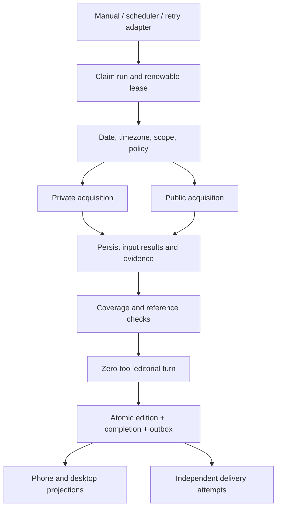

# Unified Brief — TECH

## Context

Target behavior: [PRODUCT.md](PRODUCT.md). Worktree base: `23955217e90c36837b1869734b5675ffa5d1e2f8`; this checkout contains extensive uncommitted changes. References below describe inspected working files, not a claim that all changes exist in the base commit.

- `extension/robin/mail-domain.ts`: stores one review, carries handled flags forward, distinguishes today's review from stale data. `app/api/robin/gmail/check/route.ts` and `ROBIN_MAIL_TOOL_NAMES` currently allow review-time task/calendar writes.
- `extension/robin/ai-weekly-domain.ts`: immutable previous-week editions in a separate JSON domain, source verification, renewable ownership, explicit read state and uncertain delivery handling. `lib/ai-weekly-runner.ts` schedules it in the web process.
- `scripts/telegram/bridge.ts`: separately composes daily agenda and mail digests; `docs/robin-notifications.md` defines channel/ledger semantics. Do not start a duplicate scheduler in the web process.
- `extension/robin/calendar-domain.ts`: merges local records and read-only Google events. Source failures are not empty-calendar evidence.
- `extension/robin/task-store.ts`: selected v3 SQLite owns six collections and eleven existing operational documents. Existing JSON/SQLite selection, backups and fail-closed rules must not be bypassed.

## Proposed changes

### Ownership and deployment

Robin, not the Pi session runtime, owns this feature. No Pi extension API, model provider or session-file format changes. Use built-in `node:sqlite`; no generic workflow engine, Kubernetes or external queue in the first deployment.

A new **Brief domain** owns its own `brief.sqlite` database. This is a new domain, NOT a second copy of task/mail storage and NOT a hidden v3 migration. A separate file isolates the shadow rollout and allows publication, run fencing and eventual outbox insertion to share one transaction. It also means a brief action and a Todo write are NOT one transaction: the future action adapter needs a durable idempotency key in the target domain before automatic execution is enabled. Do not claim cross-database atomicity.

The file is created only by an explicit initialization command, from a private staging database. The current schema is v2; an existing v1 Brief store requires an explicit `upgrade --writers-stopped`, with a verified/fsynced `VACUUM INTO` backup and one schema transaction. Active leases and concurrent changes during backup are refused. No upgrade was run against real data. Existing invalid/newer files fail closed; reads never initialize, upgrade or fall back to JSON. Backup/export for this new database is additional to `robin:storage`, which does not back it up. Use SQLite backup/VACUUM INTO while live; never copy only the main WAL database. No retention/deletion in milestone 1.

### Pipeline and modules

- `brief.ts`: client-safe source/result/edition vocabulary and pure deterministic shadow assembly. No model-generated fact claims in this milestone.
- `brief-store.ts`: private storage implementation, schema initialization, bounded transactions; imported only by the Brief domain.
- `brief-domain.ts`: small public interface for initialization, status/history and execution. Claims, source result commits, lease fencing, resume, verification and edition publication belong here, not in routes.
- `brief-sources.ts`: read-only adapters over Mail, Calendar, Todo and Weekly domain interfaces. No direct import of `store.ts` and no task/calendar mutators. Failures become per-source gaps; raw exception strings are not persisted.
- `brief-acquisition.ts`: private acquisition seam over the owning run's fenced transaction callback. Durable request reservations, atomic source cursor/observation/tombstone commits, immutable content-digested evidence and reference/passage checks. Storage failures propagate rather than becoming source gaps.
- `brief-mail.ts`: bounded read-only Gmail bootstrap/history adapter. Saves page membership before hydration, handles deletions/label changes, expired cursors, oversized-body metadata fallback and account revocation. Reuses `gmail.ts`'s pure best-effort extraction and the existing primary Google OAuth helper; never calls the mail-review writer or a task/event mutator.
- `scripts/robin-brief.ts`: operator entry point (`init`, `upgrade --writers-stopped`, `status`, `shadow <request-id>`, `acquire <new-request-id>`, `inspect`). `acquire` swaps only the mail adapter; other sources remain stored/local-only. No implicit real-data execution during development.

Future HTTP and Pi-tool adapters must call the same domain interface. They are not needed to prove the first vertical slice; no new UI or scheduled execution in milestone 1.

### Persisted concepts

| Concept | Identity / invariant |
| --- | --- |
| Run | UUID plus unique caller request ID; day, timezone, owner token, lease, state, timestamps; same request resumes rather than duplicates |
| Source result | `(run, source)`; minimized normalized input, observed time, upstream freshness/coverage; committed before composition and reused on retry |
| Run step | Stage/source, outcome and timing; no raw prompts or credentials in diagnostic text |
| Edition | `(day, timezone, revision)`; immutable payload and run reference; milestone 1 is constrained to `shadow` |
| Acquisition checkpoint | v2 `brief_source_state`: mailbox/policy key, bootstrap generation, watermark, page token and remaining IDs; never advance beyond uncommitted observations |
| Evidence | v2 `brief_evidence`: immutable source/message/content identity, normalized text, metadata, digest and observation time; source snapshots cite it |
| Latest source record | v2 `brief_source_items`: account/policy/message pointer to evidence, or a deletion/exclusion tombstone; generation isolates expired-cursor rebuilds |
| Budget | v2 `brief_budgets`: cumulative request reservations per run, committed before dispatch; retries do not refund uncertain calls |
| Outbox | Future: publication transaction inserts a unique delivery intent for edition/channel/audience; no send capability or fake delivery rows in milestone 1 |

A run's preparation freezes scope, not a fictionally simultaneous external-world snapshot. Each source has its own observation time. Once acquisition completes, the saved input manifest is frozen for composition. A resumed run reuses its saved source results; a new request intentionally acquires newer inputs.

An adapter checkpoint in milestone 1 means a saved **source result for this run**, not a Gmail incremental cursor. M2a separately implements provider checkpoints: evidence/tombstone + remaining queue + progress step commit together. New runs continue that cursor; completed runs still return their frozen editions. Run input profiles (`stored-v1` or `gmail-v1`) cannot be switched under an existing request ID. For transcript sources use stable session/branch entry identities, not only turn counts or file mtime; rewind/compaction/branch changes must not skip entries.

### Execution invariants

1. Claim under `BEGIN IMMEDIATE`; only one non-expired shadow run may execute at a time. A replacement owner receives a fresh token. Every source commit, failure update and publication checks token and lease inside the same transaction.
2. No awaits/network inside transactions. Heartbeats are independent short writes. Abort/ownership loss forbids publication. The initial execution has a fixed bounded deadline.
3. Persist source results individually; resume skips only successfully stored source results for that run. A cancelled/failed operation retains them. A deliberate refresh uses a new request ID.
4. Validate source identities, bounds, dates, item IDs, links and completeness before publication. Duplicate IDs within a source fail validation rather than silently overwriting content. All-unavailable fails; successfully read empty sources remain valid evidence.
5. Build the shadow preview deterministically from stored observations. Items retain source identities, fact/summary provenance, original event/publication dates and record links. Ignore handled mail and completed/archived tasks. Do not invent relevance explanations or perform new web verification.
6. Allocate the next revision and insert the edition and completed run state in one transaction. A retry after a lost response returns that exact edition. A failed later attempt leaves the previous version readable.
7. SQLite owns serialization; no in-memory lock is the correctness boundary. Stale runs can be reported as interrupted without mutating them on GET/status.
8. Old production automation stays untouched during shadow comparison. Existing scoped research and zero-tool editorial execution are reused only in later stages, with runtime-enforced budgets rather than prompt-only limits.

### Privacy and trust

Public research gets approved public interests only. Private-source summaries never become public search queries or browser input. Research cannot access private tools; editorial turns receive bounded evidence and no tools. Public URLs will use the existing SSRF-safe public fetcher when that lane is implemented. The Gmail adapter currently uses only fixed Gmail HTTPS endpoints, refuses redirects, and never sends message contents as public queries. Browser fallback has no personal cookies, secret mounts, arbitrary private-host access or unlimited navigation; access-control failures are reported, not bypassed.

Acquired mail uses `mail-message` evidence and an untriaged `updates` section, not an automatic attention/action classification. Its normalized best-effort text may be truncated or metadata-only, explicitly reflected in coverage. Digest and exact saved-passage checks establish provenance, not truth or completeness. Stored mail summaries are `stored-review`, not verified email quotations. Stored weekly passages are `legacy-passage` with their original check time, not freshly verified evidence. Local calendar snapshots explicitly declare absent Google coverage. Both content and links remain untrusted display data.

### Migration slices

- **M1 — implemented in this change:** spec, new opt-in shadow store, four stored-data adapters, resumable/fenced deterministic run, CLI and synthetic tests. No live initialization, model spend, sends or UI cutover.
- **M2a — implemented:** bounded Gmail history pagination/cursors and immutable evidence; account/policy isolation, generation resets, deduplication, cancellation and stale-owner fencing. 32 persistent request reservations per run (including conservative OAuth lookup reservations), 2 MiB per Gmail data response, 10-second calls, existing 120-second run limit; queue/body/input bounds and exact policy in [operator notes](../../docs/brief-pipeline.md). Shared OAuth refresh retains its existing transport. No model tokens, writes to legacy domains, delivery or production cutover.
- **M2b — next:** fresh bounded Google snapshots, dated public sources and publication/passage verification, with separately enforced acquisition budgets. No unrestricted private knowledge ingestion.
- **M3 — editorial publication:** zero-tool composition, strict evidence references, partial-coverage policy, frozen input manifest and immutable real editions. Compare shadow and old production output before accepting cutover.
- **M4 — shared reading UI:** Day preview and Incoming/News full reader consume one edition; source-specific handled/read semantics stay distinct. Preserve context URLs and old weekly history. Mobile Todo/calendar refinements are a separate workstream.
- **M5 — delivery cutover:** transactional outbox, consent-checked channel adapters, recipient deduplication, uncertain receipts and latest-day policy. Disable replaced agenda/mail/weekly delivery entries explicitly; preserve old ledgers to avoid replay.
- **M6 — optional knowledge/browser lanes:** opt-in project/vault scope, local distillation, provenance, restricted browser queue, append-only export to a separate destination. Never edit source notes or upload all transcripts by default.

Rollback before M4 means stopping shadow invocations; production is unchanged. After cutover, roll back the selected reader/producer while preserving all new editions/receipts and avoiding dual senders. No migration is run from the web request path or this development session.

## Testing and validation

Synthetic temporary directories only; tests must not inspect or initialize `~/.pi/robin`.

- PRODUCT 1,5,20–24: status without database creates nothing; explicit init; stable retry result; monotonic same-day revisions; old edition survives failed refresh; corrupt/newer store refuses writes.
- PRODUCT 3,4,9,22: stale/missing mail, disconnected Google, local-only coverage, old weekly publication dates, empty-but-successful sources, all-source failure; no fabricated quotations or fresh-verification claims.
- PRODUCT 6–8,11–13: source adapters cannot invoke model/research/write APIs; snapshots do not mutate source fixtures; no send/outbox side effects.
- PRODUCT 10,14,21: concurrent run claims, resumed saved sources, expired-owner attempts to publish, stale failure writes, cancellation, deadline expiry and atomic result/step commits.
- M2a checks: actual domain runs over temporary SQLite and mocked Gmail HTTP; initial watermark vs profile head, history pages and large queued pages spanning budgets, deletion/label updates, 404 reset, invalid page tokens, account switch/revocation, byte caps/metadata fallback, durable call reservations, atomic checkpoint rollback, stale-owner/cancellation refusal, all-unavailable fallback, evidence tampering, offline upgrade/rollback and CLI receipts without private text.
- Remaining M2b–M5 gates: public/Google acquisition, malformed model output and token budgets, DST/midnight editorial policy, transactional outbox/send crash windows, delivery consent and cross-device state/replay prevention. These are not claims about current coverage.

Run `node --experimental-strip-types --test extension/robin/brief*.test.mjs`, TypeScript and targeted ESLint. Do not run `next build` during development. Passing mocked Gmail and deterministic shadow suites is not proof of real-account Gmail behavior, editorial quality, public research, delivery or iPhone presentation.
