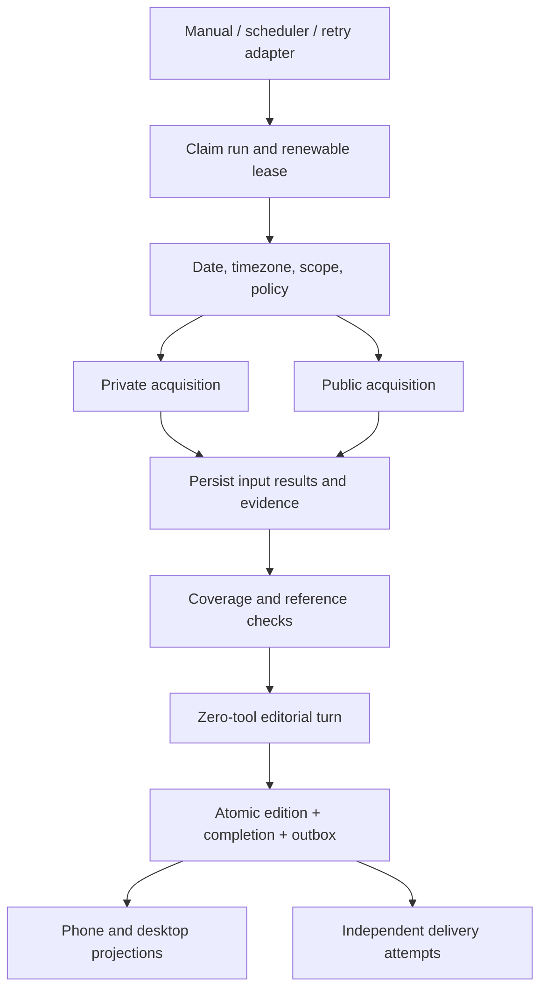

# Unified Brief — TECH

## Context

Target behavior: [PRODUCT.md](PRODUCT.md). Worktree base: `23955217e90c36837b1869734b5675ffa5d1e2f8`; this checkout contains extensive uncommitted changes. References below describe inspected working files, not a claim that all changes exist in the base commit.

- `extension/robin/mail-domain.ts`: stores one review, carries handled flags forward, distinguishes today's review from stale data. `app/api/robin/gmail/check/route.ts` and `ROBIN_MAIL_TOOL_NAMES` currently allow review-time task/calendar writes.
- `extension/robin/ai-weekly-domain.ts`: immutable previous-week editions in a separate JSON domain, source verification, renewable ownership, explicit read state and uncertain delivery handling. `lib/ai-weekly-runner.ts` schedules it in the web process.
- `scripts/telegram/bridge.ts`: separately composes daily agenda and mail digests; `docs/robin-notifications.md` defines channel/ledger semantics. Do not start a duplicate scheduler in the web process.
- `extension/robin/calendar-domain.ts`: merges local records and read-only Google events. Source failures are not empty-calendar evidence.
- `extension/robin/task-store.ts`: selected v3 SQLite owns six collections and eleven existing operational documents. Existing JSON/SQLite selection, backups and fail-closed rules must not be bypassed.

## Proposed changes

### Ownership and deployment

Robin, not the Pi session runtime, owns this feature. No Pi extension API, model provider or session-file format changes. Use built-in `node:sqlite`; no generic workflow engine, Kubernetes or external queue in the first deployment.

A new **Brief domain** owns its own `brief.sqlite` database. This is a new domain, NOT a second copy of task/mail storage and NOT a hidden v3 migration. A separate file isolates the shadow rollout and allows publication, run fencing and scheduled outbox insertion to share one transaction. It also means a brief action and a Todo write are NOT one transaction: the future action adapter needs a durable idempotency key in the target domain before automatic execution is enabled. Do not claim cross-database atomicity.

The file is created only by an explicit initialization command, from a private staging database. The current schema is v4; an existing v1/v2/v3 Brief store requires an explicit `upgrade --writers-stopped`, with a verified/fsynced `VACUUM INTO` backup and one schema transaction. Active leases and concurrent changes during backup are refused. No upgrade was run against real data. Existing invalid/newer files fail closed; reads never initialize, upgrade or fall back to JSON. Backup/export for this new database is additional to `robin:storage`, which does not back it up. Use SQLite backup/VACUUM INTO while live; never copy only the main WAL database. No retention/deletion in milestone 1.

### Pipeline and modules

- `brief.ts`: client-safe source/result/edition vocabulary, deterministic shadow assembly and optional validated editorial payload.
- `brief-editor.ts`: bounded candidate preparation, zero-tool editorial preamble, exact supplied-passage/reference validation, source-derived private/public sections and same-edition notification projection. No network or delivery.
- `brief-store.ts`: private storage implementation, schema initialization, bounded transactions; imported only by the Brief domain.
- `brief-domain.ts`: small public interface for initialization, status/history and execution. Claims, source result commits, lease fencing, resume, verification and edition publication belong here, not in routes.
- `brief-sources.ts`: read-only adapters over Mail, Calendar, Todo and Weekly domain interfaces. No direct import of `store.ts` and no task/calendar mutators. Failures become per-source gaps; raw exception strings are not persisted.
- `brief-acquisition.ts`: private acquisition seam over the owning run's fenced transaction callback. Durable request reservations, atomic source cursor/observation/tombstone commits, immutable content-digested evidence and reference/passage checks. Storage failures propagate rather than becoming source gaps.
- `brief-mail.ts`: bounded read-only Gmail bootstrap/history adapter. Saves page membership before hydration, handles deletions/label changes, expired cursors, oversized-body metadata fallback and account revocation. Reuses `gmail.ts`'s pure best-effort extraction and the existing primary Google OAuth helper; never calls the mail-review writer or a task/event mutator.
- `brief-calendar.ts`: bounded fresh local/Google snapshot; four calendars, two 100-event pages each, 2 MiB/response, account-change fencing and explicit partial coverage.
- `brief-public.ts`: two fixed publisher RSS feeds through the DNS-pinned public fetch guard; no private queries/cookies/model. 1 MiB/feed, 40 inspected entries, four articles/feed, original UTC dates and digest-checked normalized excerpts. This is not broad web research or independent fact-checking.
- `brief-delivery-domain.ts`: atomic publication intent, owned delivery leases, finite retries, uncertainty, read-only receipts and explicit no-send settlement; preserves old ledger/day ownership.
- `brief-schedule.ts`: default-off deployment gate, explicit private-model consent/replacement/start day and server-local wall-clock time.
- `scripts/robin-brief.ts`: operator entry point (`init`, `upgrade --writers-stopped`, `status`, `shadow <request-id>`, `acquire <new-request-id>`, `inspect`, `delivery-status`, `resolve <slot> accepted|cancelled`). `acquire` swaps only the mail adapter; other sources remain stored/local-only. No implicit real-data execution during development.

- `lib/brief-runner.ts`: explicit consent, stored/Gmail/live collection, isolated one-shot exact-empty-tool editor, 90-second editor timeout inside the overall deadline. Suppresses only this wrapper's completion notifications before prompting; sanitizes provider failures. No remembered conversation pointer, but existing Pi transcript persistence still applies.
- `app/api/robin/brief/route.ts`: private/no-store GET, explicit consented POST; origin/JSON guards, stable request ID and validated input mode. Reads cannot initialize or upgrade storage. No registered Pi tool or scheduler.
- `lib/brief-delivery-runner.ts` + `/api/robin/brief/tick`: trusted daily generation/dispatch adapter over domain invariants; independently checks original ledgers, subscriptions, current day and deployment consent. Only the existing bridge owns the timer; manual POST cannot use the reserved daily request prefix or add delivery intent.
- `components/robin/BriefBoard.tsx`: shared full reader/Home preview, fixed edition links, same-version notification content, bounded consent form and per-tab retry identity/input mode. Date/headline/priorities precede source, generation and receipt disclosures on one opaque reading sheet. Successful completion never writes router state; a receipt opens the saved version. Source tabs keep their state and stop automatic polling while inactive.

### Persisted concepts

| Concept | Identity / invariant |
| --- | --- |
| Run | UUID plus unique caller request ID; day, timezone, owner token, lease, state, timestamps; same request resumes rather than duplicates |
| Source result | `(run, source)`; minimized normalized input, observed time, upstream freshness/coverage; committed before composition and reused on retry |
| Run step | Stage/source, outcome and timing; no raw prompts or credentials in diagnostic text |
| Edition | `(day, timezone, revision)`; immutable payload and run reference; milestone 1 is constrained to `shadow` |
| Acquisition checkpoint | v2 `brief_source_state`: mailbox/policy key, bootstrap generation, watermark, page token and remaining IDs; never advance beyond uncommitted observations |
| Evidence | v2 `brief_evidence`: immutable source/message/content identity, normalized text, metadata, digest and observation time; source snapshots cite it |
| Latest source record | v2 `brief_source_items`: account/policy/message pointer to evidence, or a deletion/exclusion tombstone; generation isolates expired-cursor rebuilds |
| Budget | v2 `brief_budgets`: cumulative request reservations per run, committed before dispatch; retries do not refund uncertain calls |
| Editorial attempt | v3 `brief_edits`: run/input hash, pre-dispatch reservation, validated raw output; one turn per request, unknown outcome never auto-retried |
| Outbox | v4 `brief_outbox`: unique day/timezone slot and fixed edition; phone-only, expiry, owner/lease, attempts, next attempt and acceptance state; no outbox for manual previews |

A run's preparation freezes scope, not a fictionally simultaneous external-world snapshot. Each source has its own observation time. Once acquisition completes, the saved input manifest is frozen for composition. A resumed run reuses its saved source results; a new request intentionally acquires newer inputs.

An adapter checkpoint in milestone 1 means a saved **source result for this run**, not a Gmail incremental cursor. M2a separately implements provider checkpoints: evidence/tombstone + remaining queue + progress step commit together. New runs continue that cursor; completed runs still return their frozen editions. Run input profiles (`stored-v1`, `gmail-v1`, `editor-stored-v1`, `editor-gmail-v1` or `editor-live-v1`) cannot be switched under an existing request ID. For transcript sources use stable session/branch entry identities, not only turn counts or file mtime; rewind/compaction/branch changes must not skip entries.

### Execution invariants

1. Claim under `BEGIN IMMEDIATE`; only one non-expired shadow run may execute at a time. A replacement owner receives a fresh token. Every source commit, failure update and publication checks token and lease inside the same transaction.
2. No awaits/network inside transactions. Heartbeats are independent short writes. Abort/ownership loss forbids publication. The initial execution has a fixed bounded deadline.
3. Persist source results individually; before editor reservation, unavailable sources may retry. After reservation, the entire source manifest is frozen, including unavailable gaps; missing snapshots fail closed. An uncertain editor result stops before acquisition. A cancelled/failed operation retains its snapshots; a deliberate refresh uses a new request ID.
4. Validate source identities, bounds, dates, item IDs, links and completeness before publication. Duplicate IDs within a source fail validation rather than silently overwriting content. All-unavailable fails; successfully read empty sources remain valid evidence.
5. CLI previews remain deterministic; explicit editorial runs add model-written text over bounded frozen candidates. Items retain source identities, original dates and links. Ignore handled mail and completed/archived tasks. The editorial input hash, reservation and validated output are fenced; publication failure can reuse the saved output. Never relabel model judgment as verified fact or claim new web verification.
6. Allocate the next revision and insert the edition, completed run state and optional scheduled delivery intent in one transaction. A retry after a lost response returns that exact edition. A failed later attempt leaves the previous version readable.
7. SQLite owns serialization; no in-memory lock is the correctness boundary. Stale runs can be reported as interrupted without mutating them on GET/status.
8. Automation is default-off. When explicitly activated, only agenda/mail are handed off; jobs/reminders/weekly remain independent. Editorial composition reuses one-shot scoped execution with zero tools and silent completion; fixed public acquisition never receives private content. Eight candidates/source, a 50,000-character input, eight returned items, four source IDs/item and 32,000 accepted output characters are runtime-validated. One turn is reserved before dispatch; an uncertain result cannot be retried under that ID. These do not impose a hard provider token/currency cap or count SDK/provider-internal retries. Empty candidate sets spend no model turn.

### Privacy and trust

Public research gets approved public interests only. Private-source summaries never become public search queries or browser input. Research cannot access private tools; editorial turns receive bounded evidence and no tools. The fixed public feeds use the existing SSRF-safe, DNS-pinned fetcher with no redirects; only same-publisher HTTPS article links are admitted. The Gmail adapter currently uses only fixed Gmail HTTPS endpoints, refuses redirects, and never sends message contents as public queries. Browser fallback has no personal cookies, secret mounts, arbitrary private-host access or unlimited navigation; access-control failures are reported, not bypassed.

Acquired mail uses `mail-message` evidence and an untriaged `updates` section, not an automatic attention/action classification. Its normalized best-effort text may be truncated or metadata-only, explicitly reflected in coverage. Digest and exact saved-passage checks establish provenance, not truth or completeness. Stored mail summaries are `stored-review`, not verified email quotations. Stored weekly passages are `legacy-passage` with their original check time, not freshly verified evidence. Local-only calendar snapshots explicitly declare absent Google coverage; live snapshots report failed/unfinished pages. `public-feed` evidence means a normalized publisher excerpt with an original UTC publication date, not an independently verified article. Both content and links remain untrusted display data.

### Opt-in combined morning on the existing mail schedule

The original `ROBIN_BRIEF_MODE=mail` behavior remains unchanged until **both** bridge and Web set `ROBIN_BRIEF_MORNING_DAILY=1`. The bridge then suppresses the legacy agenda alongside the existing legacy mail digest; Web's 08:00 slot uses immutable input profile `mail-daily-v1`, collecting calendar → fixed public feeds → local due tasks → complete mail review. Each non-mail snapshot is saved once before bounded/resumable mail batches. The morning edition projects a maximum of six personal highlights and two publisher stories from those snapshots and the already-paid, evidence-linked mail review; it does not run a second editorial model. The same outbox slot stores one edition and advances the full-mail coverage only on push acceptance. A published combined morning slot also fences legacy agenda replay if the gate is later removed. The old 08:00 `mail-all-v2` and 18:00 `mail-all-v2` profiles and immutable editions remain valid. The 18:00 collector still reviews every mail in its full lookback and keeps its full list, but with the gate enabled selects highlights for post-08:00 arrival, action-required or failed review only. A gate change during a slot stops dispatch rather than silently switching policy; request IDs cannot switch profiles. No schema migration, new outbound channel, free-form public search or automatic task writes. Activate only after a coordinated next-boundary rollout and live review.

### Migration slices

- **M1 — implemented in this change:** spec, new opt-in shadow store, four stored-data adapters, resumable/fenced deterministic run, CLI and synthetic tests. No live initialization, model spend, sends or UI cutover.
- **M2a — implemented:** bounded Gmail history pagination/cursors and immutable evidence; account/policy isolation, generation resets, deduplication, cancellation and stale-owner fencing. 32 persistent request reservations per run (including conservative OAuth lookup reservations), 2 MiB per Gmail data response, 10-second calls, existing 120-second run limit; queue/body/input bounds and exact policy in [operator notes](../../docs/brief-pipeline.md). Shared OAuth refresh retains its existing transport. No model tokens, writes to legacy domains, delivery or production cutover.
- **M2b — bounded implementation:** fresh Google snapshots and two fixed public feeds with immutable evidence/date/passage checks. Live acquisition orders calendar/public before Gmail under the shared durable request budget. Public coverage expansion and independent verification remain follow-ups; no unrestricted private knowledge ingestion.
- **M3 — preview implemented, production gate pending:** zero-tool composition, strict supplied-reference/passage checks, bounded candidate input, frozen manifest and one reserved editor turn. Output survives a publication rollback. Independent claim/relevance/date fidelity and live model quality still need evaluation; no production cutover.
- **M4 — shared reader implemented:** Home card and Incoming full reader consume one edited edition, with exact-version links, matching notification content and collapsible delivery receipts. One reading sheet puts the first priority ahead of operational controls. Consent/retry identity, input-mode isolation, failure receipts and navigation races are covered. Source-specific handled/read semantics, context URLs and weekly history stay intact. Mobile Todo/calendar refinements remain separate.
- **M5 — implementation complete, live cutover pending:** transactional outbox, phone transport reuse, original-ledger checks before/after composition and dispatch, 120-second owner/60-second wait, five-minute bounded retries, uncertain/abandoned no-resend policy, day/expiry fence and manual receipt settlement. Only agenda/mail are replaced. Both processes require the same explicit configuration; stop/drain the old bridge, preserve ledgers and start only one scheduler. See the [operator checklist](../../docs/brief-pipeline.md#gated-schedule-delivery-and-cutover). This is not exactly-once delivery.
- **M6 — optional knowledge/browser lanes:** opt-in project/vault scope, local distillation, provenance, restricted browser queue, append-only export to a separate destination. Never edit source notes or upload all transcripts by default.

Rollback of this preview means stopping new invocations and optionally removing the reader/card; legacy production is unchanged. After cutover, roll back the selected reader/producer while preserving all new editions/receipts and avoiding dual senders. No migration is run from the web request path or this development session.

## Testing and validation

Synthetic temporary directories only; tests must not inspect or initialize `~/.pi/robin`.

- PRODUCT 1,5,20–24: status without database creates nothing; explicit init; stable retry result; monotonic same-day revisions; old edition survives failed refresh; corrupt/newer store refuses writes.
- PRODUCT 3,4,9,22: stale/missing mail, disconnected Google, local-only coverage, old weekly publication dates, empty-but-successful sources, all-source failure; no fabricated quotations or fresh-verification claims.
- PRODUCT 6–8,11–13: source adapters cannot invoke model/private-write APIs; snapshots do not mutate source fixtures; manual previews have no send/outbox side effects.
- PRODUCT 10,14,21: concurrent run claims, resumed saved sources, expired-owner attempts to publish, stale failure writes, cancellation, deadline expiry and atomic result/step commits.
- M2a checks: actual domain runs over temporary SQLite and mocked Gmail HTTP; initial watermark vs profile head, history pages and large queued pages spanning budgets, deletion/label updates, 404 reset, invalid page tokens, account switch/revocation, byte caps/metadata fallback, durable call reservations, atomic checkpoint rollback, stale-owner/cancellation refusal, all-unavailable fallback, evidence tampering, offline upgrade/rollback and CLI receipts without private text.
- M3/M4 preview checks: malformed/forged/mixed-lane references, fair bounded sampling, uncertain turn reservations, cached-result publication recovery, cancellation, source-profile immutability, read-only GET, consent/origin guards, private provider error masking, silent one-shot completion, same-edition reader/notification/Home projection, browser retry and pending-navigation races. All model/API outputs are synthetic.
- M2b/M5 tests: bounded/aborted/malformed calendar feeds, account changes, public-only request identity, historical/future dates, foreign URLs/redirects/DTDs, immutable proof, atomic outbox rollback, no regeneration on retry, transport hangs/late owners, conservative uncertainty, original ledger handoff, consent changes, midnight/DST and route isolation.
- Remaining live gates: real-account/calendar/model fidelity and relevance, provider token/currency behavior, agreed deployment date, actual phone display/link and operational backups/retention. A public-only HTTP/parser probe checked both configured feeds without reading private data or initializing storage.

Run the domain, runner, route and assistant regression commands in [operator notes](../../docs/brief-pipeline.md), TypeScript and targeted ESLint; `e2e/unified-brief.mjs` checks synthetic mobile/desktop glass/dark readers and the Home projection. Do not run `next build` during development. These checks are not proof of real Gmail/model behavior, editorial quality, fresh public research, delivery or native iPhone behavior.
